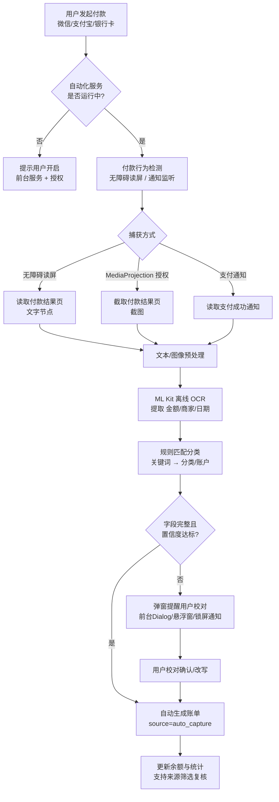
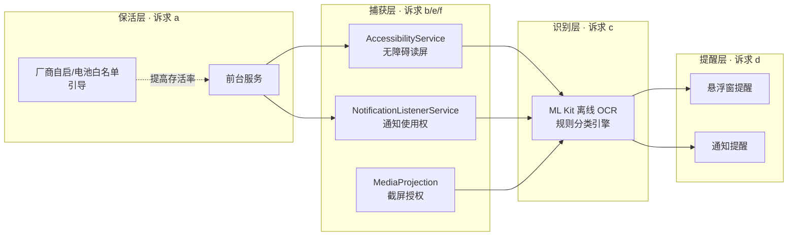

# 记账 App 整合产品需求文档（PRD）

| 项目 | 内容 |
| --- | --- |
| 文档版本 | V1.1（整合版） |
| 基线来源 | V1.0 原始 PRD + 用户新追加「系统级自动化」需求 |
| 文档用途 | 交付架构师进行系统设计与任务分解；需求颗粒度细、逻辑完整、功能基线不删减 |
| 产品形态 | 个人自用、不上架应用商店、本地优先（离线模式） |
| 目标平台 | Android 原生（本次 V1 唯一交付平台） |
| 技术栈基线 | Android 原生 Kotlin + Room 数据库 + ML Kit 离线 OCR |
| 最终用户 | 阿祖（本人），北京，C++/Qt 3 年经验，资深工程师 |

> **阅读约定**：需求强度采用 `必须 / 应 / 可`（对应 Must / Should / Nice-to-have）；优先级采用 P0（必须有）/ P1（应该有）/ P2（可以有）。
> **本次差异化重点**：第 22 章「智能自动化记账模块」，含技术可行性速判与降级实现，请架构师重点阅读。

---

## 目录

- [0. 本次整合变更说明](#0-本次整合变更说明)
- [1. 产品概述](#1-产品概述)
- [2. 用户角色](#2-用户角色)
- [3. 核心目标](#3-核心目标)
- [4. 整体数据基础定义](#4-整体数据基础定义)
- [5. 账号与基础设置模块](#5-账号与基础设置模块)
- [6. 账本管理模块（多账本）](#6-账本管理模块多账本)
- [7. 账单录入模块（手动记账）](#7-账单录入模块手动记账)
- [8. 【重点】外部账单导入模块](#8-重点外部账单导入模块)
- [9. 账单列表、详情、编辑删除](#9-账单列表详情编辑删除)
- [10. 分类管理 & 标签管理](#10-分类管理--标签管理)
- [11. 预算管理（按账本独立）](#11-预算管理按账本独立)
- [12. 资产账户管理](#12-资产账户管理)
- [13. 统计报表 & 图表分析](#13-统计报表--图表分析)
- [14. 账单导出功能](#14-账单导出功能)
- [15. 搜索、筛选、批量操作](#15-搜索筛选批量操作)
- [16. 备份与同步](#16-备份与同步)
- [17. 隐私安全](#17-隐私安全)
- [18. 通知提醒](#18-通知提醒)
- [19. 异常与错误处理规范](#19-异常与错误处理规范)
- [20. 非功能需求](#20-非功能需求)
- [21. 附录](#21-附录)
- [22. 智能自动化记账模块（本次新增 · 差异化重点）](#22-智能自动化记账模块本次新增--差异化重点)

---

## 0. 本次整合变更说明

### 0.1 相对 V1.0 的变更清单

| 编号 | 变更项 | 说明 | 影响章节 |
| --- | --- | --- | --- |
| C-01 | 新增「智能自动化记账模块」 | 纳入用户新追加的 6 项系统级自动化诉求（a~f），作为 V1 差异化重点 | 新增第 22 章 |
| C-02 | OCR 由二期提前至 V1 | 原始 PRD 附录 C 将「OCR 拍照识别小票」「AI 智能分类」列为二期（V1 不做）；用户本次明确要求 OCR 提前纳入 V1 | 第 21 章附录 C、第 22 章 |
| C-03 | 平台上收敛为 Android 原生 | 本次 V1 唯一交付平台为 Android 原生 Kotlin；iOS / PC 网页端不在本次范围（原始 PRD 的多端预留能力保留为二期） | 文档头、第 1、20、22 章 |
| C-04 | 技术栈基线固化 | Android 原生 Kotlin + Room + ML Kit 离线 OCR，本地优先 | 文档头、第 22 章 |
| C-05 | 明确「仅个人自用、不上架」 | 用户明确无需考虑上架合规；但涉及系统敏感权限的能力仍按 Android 标准 API 约束落地并如实标注限制 | 第 22 章 |
| C-06 | 数据字段扩展 | 账单基础字段新增自动化相关字段（source 枚举扩展、识别置信度、原始捕获图路径等） | 第 4 章、第 22 章 |

### 0.2 已确认决策（用户已拍板，不再二次确认）

| 编号 | 决策项 | 用户确认结论 | 落地约束 |
| --- | --- | --- | --- |
| D-01 | 付款截屏方式 | **采用「后台自动截屏监听」方案**（用户主动选择，替代手动截图录入） | 技术侧按第 22.3 可行性标注降级实现：优先 AccessibilityService 读屏拿文字节点；真·截屏走 MediaProjection 并需授权；完全静默无授权截屏不做（需 root） |
| D-02 | 使用范围 | **仅个人自用、不上架应用商店**，用户明确表示无需考虑上架合规 | 可使用无障碍服务、通知使用权、悬浮窗等敏感权限；仍须在应用内清晰说明用途并引导用户手动授权 |
| D-03 | OCR 识别范围 | **OCR 纳入 V1**（覆盖原始 PRD 附录 C 的二期安排） | 采用 ML Kit 离线文字识别，不依赖网络；低置信度走弹窗人工校对 |

### 0.3 技术限制总原则（面向资深工程师的结论先行）

> 本 App 运行在标准 Android 沙盒内，**不具备 root / 系统签名 / Xposed 权限**。因此第 22 章中标注为 ❌ 的诉求（强杀自启、锁屏识别支付界面内容、iOS 后台能力）在 V1 中**无法实现**，一律以「明确告知 + 可行降级方案」落地，不做虚假承诺、不隐瞒限制。

---

## 1. 产品概述

面向 C 端个人用户的轻量化记账应用，对标市面主流记账软件全部基础能力，同时强化跨软件账单迁移能力，支持从微信、支付宝、银行卡、鲨鱼记账、随手记等主流记账工具导出的账单文件一键导入，解决用户换记账软件、历史账单无法迁移的痛点。

- **支持平台**：原始 PRD 规划先做移动端（Android / iOS），预留 PC 网页端适配能力。**本次 V1 收敛为 Android 原生**（iOS 原生及 PC 网页端顺延二期；iOS 上第 22 章全部后台自动化能力因沙盒隔离无法实现，详见 22.3）。
- **存储策略**：本地存储优先，可选云端同步；本次 V1 默认离线模式。
- **产品定位**：简单稳定、导入兼容性强、统计清晰、无强制广告；本次 V1 额外强化「付款后自动捕获—识别—分类—入账」的自动化能力。

## 2. 用户角色

| 角色 | 说明 |
| --- | --- |
| 普通个人用户（唯一角色） | 自己管理全部账本、资产、账单；暂不支持多人共享账本 |
| 二期可选扩展 | 共享账本、家庭记账 —— V1 不做，仅保留数据结构扩展位 |

## 3. 核心目标

1. 支持快速手动录入收入、支出、转账账单，支持重复周期记账。
2. 兼容市面主流账单导出文件，导入时自动匹配分类、账户，提供人工校对界面。
3. 账户资产实时计算，自动统计余额，信用卡单独统计负债。
4. 自定义收支分类、标签，适配用户记账习惯。
5. 月度 / 年度预算管控，超预算提醒。
6. 多维度图表：饼图、柱状图、趋势折线图。
7. 本地备份 + 云端备份，支持自己导出全部账单。
8. 数据隐私优先，账单数据加密存储。
9. **（本次新增）** 付款行为自动捕获 + OCR 智能识别分类 + 低置信度弹窗校对，最小化手动录入。

## 4. 整体数据基础定义

账单统一分 3 种类型：**支出**（钱流出）、**收入**（钱流入）、**转账**（账户 A 到账户 B，不计入收支，只变更两账户余额）。

### 4.1 账单基础字段（所有账单通用）

| 字段名 | 类型 | 是否必填 | 说明 |
| --- | --- | --- | --- |
| bill_id | 唯一主键 | 是 | 系统自动生成 |
| book_id | 账本 ID | 是 | 归属哪个账本 |
| bill_type | 枚举 | 是 | 支出 / 收入 / 转账 |
| amount | 小数 (2 位) | 是 | 金额，正数；转账时转出金额 = 转入金额 |
| category_id | 分类 ID | 是 | 支出/收入分类；转账可为空 |
| tag_list | 数组 | 否 | 多个标签，最多 10 个 |
| account_from | 账户 ID | 是 | 资金流出账户 |
| account_to | 账户 ID | 转账必填 | 资金流入账户；支出=空；收入=account_from 空 |
| bill_time | 时间戳 | 是 | 账单发生时间（导入以这个时间排序，不是导入时间） |
| remark | 文本 | 否 | 备注、商家名称 |
| image_list | 图片数组 | 否 | 小票照片，最多 9 张 |
| cycle_type | 枚举 | 否 | 非周期 / 每日 / 每周 / 每月 / 每年 |
| cycle_end_time | 时间戳 | 否 | 周期结束时间 |
| source | 枚举 | 是 | manual 手动 / import 导入 / **auto_capture 自动捕获（本次新增）** |
| create_at | 时间戳 | 是 | 本条记录创建时间 |
| update_at | 时间戳 | 是 | 修改时间 |

### 4.2 自动化扩展字段（本次新增，详见 22.8）

| 字段名 | 类型 | 是否必填 | 说明 |
| --- | --- | --- | --- |
| capture_type | 枚举 | 否 | accessibility_text 读屏文本 / projection_image 截屏图像 / notification 通知 |
| capture_image_path | 文本 | 否 | 原始捕获截图本地路径（加密存储） |
| ocr_confidence | 小数 | 否 | OCR 整体置信度 0~1，用于触发低置信度弹窗 |
| ocr_raw_text | 文本 | 否 | OCR 原始识别文本，便于二次校对与规则迭代 |
| verify_status | 枚举 | 否 | auto_passed 自动通过 / user_confirmed 用户校对通过 / user_corrected 用户改写 |

## 5. 账号与基础设置模块

### 5.1 账号登录（可选，本地模式可免登录）

1. **本地离线模式（默认推荐）**：不需登录，数据保存在设备本地；可手动备份文件。
2. **云同步模式**：手机号验证码登录，多端同步；登录后云端加密存储。
   - 支持退出登录；退出后云端不再自动同步，本地数据保留。
   - 忘记密码：短信验证码重置。

> 本次 V1 默认离线模式，账号登录与云同步保留为可选能力。

### 5.2 基础设置页面

货币单位（默认 CNY，只改符号不做汇率换算）、日期格式、周起始日、默认账本、默认账户、默认分类、导入设置入口（账单导入映射管理）、备份管理入口、隐私设置（应用锁）、清除缓存、关于我们、版本更新。

> 本次新增入口：**自动化记账设置**（前台服务开关、无障碍/通知使用权授权引导、截屏方式选择、低置信度阈值、弹窗方式设置），详见 22.6 / 22.9。

## 6. 账本管理模块（多账本）

账本之间数据完全隔离。

- **字段**：账本 ID、名称、图标、描述、创建时间、是否默认、状态（启用/归档）。
- **功能**：
  - 创建账本（内置模板：日常 / 家庭 / 旅行 / 生意）。
  - 切换账本、编辑、归档（归档后仍可查询导出，不能新增）。
  - 删除（强提醒 + 二次确认，删除该账本下所有账单/账户/分类/预算，不可恢复）。
  - 导入时可选择导入到当前账本或新建账本存放。

## 7. 账单录入模块（手动记账）

首页突出【+】快速记账按钮，弹出记账表单。

- **流程**：选类型（支出/收入/转账）→ 填金额（数字键盘，两位小数）→ 选分类（分类树 + 搜索）→ 选账户（支出扣款 / 收入收款 / 转账转出转入）→ 选时间（默认当前）→ 标签（最多 10 个）→ 备注 → 添加照片（最多 9 张）→ 周期设置（每日/每周/每月/每年；两种模式：自动入账 / 提醒待入账（推荐））→ 保存后立刻更新余额。
- **快捷能力**：常用账单模板、快速复制账单、一键清空表单。

## 8. 【重点】外部账单导入模块

**目标**：从其他 App 导出 CSV / Excel 账单上传，解析、自动映射字段、自动匹配分类账户、预览校对、批量导入。

- **支持来源**：微信账单、支付宝账单、银行流水、鲨鱼记账 csv、随手记 csv。
- **格式**：.csv（优先）、.xlsx；V1 暂不支持 pdf、图片 OCR 导入（**注**：图片 OCR 识别已由「自动捕获模块」承接，见第 22 章；此处指「手动上传图片文件解析导入」仍不做）。

### 8.1 导入整体流程（固定 5 步）

| 步骤 | 名称 | 核心规则 |
| --- | --- | --- |
| 步骤 1 | 选择来源 | 模式 A 预设模板（微信支付/支付宝/鲨鱼记账/随手记/招商银行/工商银行/自定义文件）；模式 B 自定义导入 |
| 步骤 2 | 上传文件 | 上限 10MB；格式校验、utf-8/gbk 自动识别、空文件/行数过少拒绝；只解析文本不执行脚本 |
| 步骤 3 | 文件预览 + 字段映射【最核心】 | 读第一行表头，展示前 10 行；每列映射到标准字段；自动映射（预设模板绑定，如【交易时间】→bill_time、【金额(元)】→amount、【收支类型】→bill_type）+ 人工手动映射（下拉选，支持跳过列）。特殊规则：正负区分收支开关（负数=支出，正数=收入）；转账默认不识别，预览页手动改；分类模糊匹配（同名优先→匹配不到则自动新建或统一映射到默认分类如"其他支出"）；账户匹配（同名自动匹配→匹配不到则新建或统一映射到默认账户） |
| 步骤 4 | 账单预览校对页【必须】 | 每条展示解析出的时间/金额/类型/分类/账户/备注；支持单行编辑、单行跳过、批量修改分类/账户、批量跳过、筛选解析失败行（标红）。解析失败行（时间无法识别、金额为空/非数字）标红，必须处理或跳过。页面顶部统计摘要：总解析行数、有效数、失败数、跳过数、预估余额变化 |
| 步骤 5 | 确认导入 | 后台任务（上万条不卡页面），实时进度条，完成后生成导入报告（成功支出/收入/转账条数、自动新建分类/账户、失败条数 + 下载失败明细 csv） |

### 8.2 导入规则约束

1. **去重逻辑（重中之重）**：同一账本 + 相同交易时间（精确到秒）+ 相同金额 + 相同账户 + 相同备注 → 判定同一条跳过。页面开关【开启重复账单检测】默认开，关闭则强制全部导入。
2. 导入账单统一标记 `source=import`。
3. 导入账单同等参与余额计算。
4. 导入不生成周期账单，全部一次性。
5. 转账识别：预设模板有"转账"标记才导入为转账；自定义文件默认不识别，需手动改。

### 8.3 导入映射方案持久化

映射关系可保存为自定义模板，下次直接选用；可管理删除。

### 8.4 导入异常场景

时间格式多样（2025-10-01、10/01、2025/10/01、2025年10月1日）内置多解析器，失败标红；金额带中文符号（¥123.45、1,234.00 千分位）自动清洗；金额为空标记失败；多币种 V1 不换算提醒核对；超大文件（>5000 行）提示 + 后台导入。

## 9. 账单列表、详情、编辑删除

- **首页账单列表**：按时间倒序，日期分组，日期头部显示当日收入/支出/净收支；卡片展示图标/分类/备注/时间/金额（支出红、收入绿、转账灰）/账户；下拉刷新、上拉加载更多、无限分页。
- **详情页**：展示全部字段；操作：编辑、复制账单、删除、分享备注图片。
- **编辑**：修改金额/分类/账户后自动重新计算余额（示例：支出 100 改 200，零钱余额自动再扣 100）。
- **删除**：反向回滚余额，弹窗确认，可开启二次确认。导入批量账单删除单条只删本条。

## 10. 分类管理 & 标签管理

- **收支分类**：两套独立树（最多二级）。
  - 默认支出分类：餐饮、交通、住房、购物、医疗、娱乐、通讯、学习、人情、其他支出。
  - 默认收入分类：工资、奖金、红包、兼职、理财收益、其他收入。
  - 功能：新增一级/二级、改名改图标排序、删除（有账单绑定则先迁移再删）、排序。导入自动匹配这里的分类名称。
- **标签**：扁平结构，归属当前账本，新增/改名/删除（删标签不删账单，只取消绑定），账单可多标签，报表可按标签筛选。

> 分类名称为第 22 章 OCR 规则匹配分类的匹配目标，分类增删改需实时同步到自动分类规则引擎。

## 11. 预算管理（按账本独立）

月度预算（V1），两种模式：总预算（账本当月总支出上限）、分类预算（每个支出分类单独）。页面展示已支出/预算总额 + 进度条；超预算提醒（App 红点 + 推送）；预算统计对比；每月 1 号自动重置 + 手动重置。转账不计入预算，只有支出消耗预算。

## 12. 资产账户管理

- **账户类型**：现金、微信零钱、支付宝余额、储蓄卡、信用卡（负债，余额负数代表欠款）、理财账户、虚拟钱包、自定义。
- **字段**：ID、名称、类型、初始余额、图标、备注。
- **核心逻辑**：储蓄卡/现金余额 = 初始 + 流入 - 流出 + 转入 - 转出；信用卡反向（支出=欠款增加，还款=欠款减少）；余额校准（输入实际余额，自动生成一条【余额调整账单】，单独标记，不计入收支统计）。
- **账户列表**：展示名称/类型/当前余额；顶部总资产（信用卡负债扣减，展示净资产）；新增、编辑、停用（停用后不能选，历史保留）、删除（有账单则先迁移）。

## 13. 统计报表 & 图表分析

- **范围**：当前账本；**时间范围**：今日/本周/本月/本年/自定义。
- **Tab**：概览（总收入/总支出/净结余/预算完成）、支出饼图（点击下钻）、收入饼图、趋势图（柱状/折线，按天/周/月）、分类明细表格、账户分析、标签统计。
- 图表可点击下钻账单列表、可截图保存。转账不进收支统计和饼图，仅在账户流水体现。

## 14. 账单导出功能

选择账本、时间范围、格式（csv/xlsx）、可选字段勾选；导出到本地；utf-8 编码带表头。

## 15. 搜索、筛选、批量操作

搜索备注/分类/标签模糊匹配；高级筛选（时间/类型/分类/账户/标签/金额区间/来源组合）；批量修改分类/账户/打标签/删除。

> 来源筛选需支持 `auto_capture`（自动捕获），便于用户集中复核自动化生成的账单。

## 16. 备份与同步

本地备份（全账本数据包加密文件，含账单/分类/账户/图片索引，可恢复，恢复覆盖前二次确认）；云同步（登录模式增量同步，冲突以最后修改时间晚为准 + 弹窗选择）；自动备份开关（每天凌晨本地备份）。

## 17. 隐私安全

应用锁（数字密码/指纹/面容，退出多久自动上锁）；云存储 HTTPS + AES 加密；截图保护（可选 Android）；不收集不必要信息，不主动上传账单除非开启云同步；导入文件只在本地解析，离线模式全程本地处理。

> 第 22 章的截屏/OCR/通知读取全部在设备本地完成，不上传云端；捕获图像加密存储并可在设置中一键清除（详见 22.9）。

## 18. 通知提醒

周期账单提醒、预算超支提醒、每日记账提醒（自定义时间）；需申请通知权限，可关闭。

> 第 22 章低置信度弹窗在应用后台时通过通知 + 悬浮窗呈现，复用此通知权限体系。

## 19. 异常与错误处理规范

大文件内存溢出（分片读取逐行解析）；余额计算异常（打标记 + 资产页提示）；数据库写入失败（提示不静默丢失）；网络异常（本地先存联网重试）；文件解析乱码（UTF8/GBK 切换按钮）。

> 自动化模块异常处理见 22.9；权限缺失/服务被杀必须显式提示，不静默失败。

## 20. 非功能需求

| 类别 | 指标 |
| --- | --- |
| 性能 | 账单 10 万条内流畅；导入 1 万条 < 10s |
| 兼容性 | 原始规划 Android 8.0+ / iOS 14+；**本次 V1 交付 Android 原生，最低 Android 8.0（API 26）**；第 22 章部分能力受系统版本约束（详见 22.3） |
| 图片 | 压缩处理 |
| 网络 | 离线优先；OCR 离线识别 |
| UI | 简约干净，支出红、收入绿、转账灰 |
| 稳定性 | 后台服务被系统回收后需可恢复（在标准系统约束内），不得导致数据丢失或重复入账 |

## 21. 附录

- **附录 A 标准导出表头**：`bill_time,bill_type,amount,category_name,account_from,account_to,tag,remark,source`
  - 示例：`2026-10-01 12:30:00,支出,25.50,餐饮-午餐,微信零钱,,外卖,manual`
- **附录 B 微信账单映射**：交易时间→bill_time、交易类型→bill_type、金额(元)→amount、交易对方→remark、支付方式→account_from
- **附录 C 二期预留（V1 不做）**：多人共享账本、理财收益自动计算、~~OCR 拍照识别小票~~、~~AI 智能分类~~、债务管理、外币汇率换算、PC 网页独立版。
  - **⚠️ 变更（C-02）**：~~OCR 拍照识别小票~~ 与 ~~AI 智能分类~~ 已由用户确认**提前纳入 V1**（见第 22 章），从二期预留中移除，不再是「V1 不做」。

---

## 22. 智能自动化记账模块（本次新增 · 差异化重点）

### 22.1 背景与目标

- **用户诉求**：希望记账全程自动化，付款后无需手动录入，系统自动捕获付款结果、识别金额/商家/日期并分类入账，人工仅校对低置信度条目。
- **产品目标**：
  1. 付款行为发生后自动捕获付款信息（读屏 / 截屏 / 通知三路）。
  2. 通过 ML Kit 离线 OCR + 规则引擎提取并分类账单，本地完成、不联网。
  3. 信息不足或识别失败时主动弹窗提醒用户校对，保证账目准确性。
- **定位**：V1 差异化重点；全部在标准 Android 沙盒内实现，不具备 root / 系统签名 / Xposed，能力边界以 22.3 速判为准。

### 22.2 原始诉求清单（用户 a~f）

| 编号 | 用户原始诉求 | 期望效果 |
| --- | --- | --- |
| a | 申请后台常驻留存 + 强杀后自启动 | 自动化服务长期在后台运行，被强杀后能自启 |
| b | 检测到系统级付款界面结束后，自动截屏付款记录 | 支付完成页自动截图/记录 |
| c | 通过图像处理 / OCR 智能识别并分类账单类型 | 自动提取金额/商家/日期并归类 |
| d | 图像信息过少或处理失败时，主动弹窗提醒用户修改 | 低质量识别结果交由用户校对 |
| e | 支持在锁屏界面识别自动付款 | 锁屏状态下也能捕获付款 |
| f | 监控消息弹窗（支付通知） | 读取支付类通知生成账单 |

### 22.3 技术可行性速判（结论与证据链）

> 以下 6 条为主理人技术可行性速判，**原样整合、不做粉饰**。资深工程师可据此直接判断能力边界。

| # | 诉求 | 可行性 | 技术方案与证据链 | V1 落地形态 |
| --- | --- | --- | --- | --- |
| 1 | c（OCR 识别）+ d（低置信度弹窗） | ✅ **可做** | ML Kit 离线文字识别提取金额/商家/日期 → 规则匹配分类 → 字段过少或置信度低弹窗让用户改 | 完整实现，纳入 V1（决策 D-03） |
| 2 | f（监控消息弹窗） | ✅ **可做** | NotificationListenerService 读取通知栏，需用户授权「通知使用权」 | 完整实现，纳入 V1 |
| 3 | b（后台截屏监听付款界面） | ⚠️ **有条件** | AccessibilityService 读屏拿文字节点最实用；真·截屏用 MediaProjection 需授权，Android 14+ 每次会话可能重授权；完全静默无授权截屏必须 root | 主路径=无障碍读屏；备选=MediaProjection 授权截屏；静默截屏不做 |
| 4 | a（强杀后自启动） | ❌ **标准系统做不到** | Android 3.1+ 被 force-stop 的 App 无法自启；只能引导加厂商自启/电池白名单提高存活率；真正强杀自启需 root/系统签名/Xposed | 前台服务保活 + 引导加白名单；强杀自启能力明确告知不可实现 |
| 5 | e（锁屏界面识别自动付款） | ❌ **标准系统做不到** | 锁屏时第三方 App 读不到支付界面内容；可行降级=读锁屏上的支付通知；真要做需 root/Xposed | 降级为「读锁屏支付通知」（经通知使用权） |
| 6 | 上述后台能力在 iOS 上 | ❌ **全部做不到** | 沙盒隔离 | iOS 不在本次 V1 范围；顺延二期时不含后台自动化 |

**结论汇总**：a、e 为❌（以降级方案落地）；b 为⚠️（条件实现）；c、d、f 为✅（完整实现）；iOS 全部❌。

### 22.4 降级实现方案（按诉求逐条）

| 诉求 | 用户期望 | V1 实际落地 | 降级/限制说明 |
| --- | --- | --- | --- |
| a 后台常驻 + 强杀自启 | 长期保活、强杀自启 | 前台服务（Foreground Service）常驻 + 系统通知常显；引导用户加入厂商「自启动 / 电池优化白名单」 | ❌ 强杀后自启在标准系统无法实现（Android 3.1+）。仅在应用内如实说明并提供白名单引导，不承诺自启 |
| b 付款界面自动截屏 | 静默自动截屏 | 主路径：AccessibilityService 读取付款结果页文字节点（金额/商家/时间）；备选：MediaProjection 授权后截屏 | ⚠️ 真·截屏需用户授权；Android 14+ 每次会话可能需重新授权；完全静默无授权截屏需 root，不做 |
| c OCR 识别分类 | 自动识别并分类 | ML Kit 离线 OCR 提取金额/商家/日期 → 规则匹配引擎映射到分类/账户 → 生成账单（source=auto_capture） | 纯本地、离线；分类命中依赖规则库，未命中走默认分类「其他支出」并标低置信度 |
| d 低置信度弹窗 | 主动提醒修改 | 字段缺失（金额/时间/商家任一缺失）或 ocr_confidence < 阈值 → 弹窗让用户校对/修改 | 前台=普通 Dialog；后台=悬浮窗（SYSTEM_ALERT_WINDOW）+ 通知；锁屏=锁屏通知 |
| e 锁屏识别付款 | 锁屏也能识别 | 降级为读取锁屏上的支付通知（经通知使用权），提取金额/商家 | ❌ 锁屏时第三方读不到支付界面内容；真识别需 root/Xposed，不做 |
| f 监控支付通知 | 读通知生成账单 | NotificationListenerService 监听支付类通知（微信/支付宝/银行），解析金额/商家/时间生成账单 | ✅ 需用户授权「通知使用权」；按包名 + 关键词过滤，避免误捕获 |

### 22.5 核心用户故事

1. As a 用户，I want 付款完成后自动生成账单，so that 无需每次手动打开 App 录入。
2. As a 资深工程师，I want 清楚知道每项自动化能力的系统限制，so that 我能判断哪些可信、哪些需降级。
3. As a 用户，I want 识别结果不确定时弹窗让我改，so that 账目准确不被错误数据污染。
4. As a 用户，I want 只授权我认可的权限，so that 我掌控隐私边界。
5. As a 用户，I want 自动化生成的账单可被集中复核，so that 我能快速纠错。

### 22.6 权限申请清单（架构师必须逐项处理）

> 决策 D-02 已明确「仅个人自用、不上架」，可使用敏感权限；但仍须在应用内清晰说明用途并引导用户手动开启，不得静默获取。

| 权限 / 能力 | 系统标识 | 用途（对应诉求） | 是否必需 | 申请与引导方式 |
| --- | --- | --- | --- | --- |
| **无障碍服务** | `AccessibilityService` | 读屏拿付款界面文字节点（b）；辅助识别 | 主路径必需 | 不可代码直接授予，引导跳转「设置→无障碍」手动开启；需声明 service 与 accessibility_service_config |
| **通知使用权** | `NotificationListenerService` | 读取支付通知（f）；锁屏降级识别（e） | 必需 | 引导跳转「设置→通知使用权」手动开启；需声明 listener service |
| **悬浮窗** | `SYSTEM_ALERT_WINDOW` | 后台/锁屏时弹窗提醒用户校对（d） | 可选（建议） | Android 6.0+ 需引导跳转「设置→悬浮窗」授权；无此权限时降级为通知提醒 |
| **自启动白名单** | 厂商自定义（非 AOSP 标准权限） | 提高服务存活率（a） | 可选（建议） | 检测厂商机型，引导跳转对应「自启动管理 / 电池优化白名单」设置页；无法代码自启 |
| **前台服务** | `FOREGROUND_SERVICE`（Android 14+ 按类型声明，如 `specialUse`/`dataSync`） | 后台常驻保活（a） | 必需 | Android 8.0+ 必须用 `startForegroundService` 并显示常驻通知；Android 13+ 需 `POST_NOTIFICATIONS` |
| **通知权限** | `POST_NOTIFICATIONS`（Android 13+） | 低置信度提醒、保活通知、预算提醒 | 必需（13+） | 运行时申请；用户拒绝则降级 |
| **屏幕捕获** | `MediaProjection` | 真·截屏付款结果页（b 备选） | 可选 | 通过系统授权弹窗获取；Android 14+ 每次会话可能需重新授权；用户可拒绝 |
| 开机自启 | `RECEIVE_BOOT_COMPLETED` | 开机后恢复服务（a 部分） | 可选 | 清单声明；**注意：被 force-stop 后无效** |
| 电池优化白名单 | `REQUEST_IGNORE_BATTERY_OPTIMIZATIONS` | 减少 Doze 对后台服务的限制（a） | 可选 | 引导用户加入白名单；Play 上架有政策限制，但本应用不上架（D-02）不受影响 |

### 22.7 自动化记账数据流（Mermaid）

### 22.8 权限与服务依赖关系（Mermaid）

### 22.9 数据字段扩展（详见 4.2）

| 字段 | 用途 | 取值说明 |
| --- | --- | --- |
| source | 区分账单来源 | 新增枚举 `auto_capture` |
| capture_type | 捕获方式 | accessibility_text / projection_image / notification |
| capture_image_path | 原始截图路径 | 加密存储，可在设置中一键清除 |
| ocr_confidence | 识别置信度 0~1 | 低于阈值触发弹窗 |
| ocr_raw_text | OCR 原文 | 供二次校对与规则迭代 |
| verify_status | 校对状态 | auto_passed / user_confirmed / user_corrected |

> 去重规则复用 8.2：同一账本 + 秒级时间 + 相同金额 + 相同账户 + 相同备注 → 判定重复，避免通知与读屏双路捕获产生重复账单。

### 22.10 异常与用户提示规范

| 场景 | 处理方式 | 是否静默 |
| --- | --- | --- |
| OCR 字段缺失（金额/时间/商家任一） | 弹窗提醒用户补充/修改，标记 verify_status | 否，显式提示 |
| ocr_confidence 低于阈值 | 弹窗让用户校对 | 否，显式提示 |
| 捕获图像过少/模糊 | 提示重新截屏或手动录入 | 否，显式提示 |
| 无障碍服务未开启 | 设置页红点 + 引导跳转开启 | 否，显式提示 |
| 通知使用权未授权 | 首次用到时弹窗说明 + 引导授权 | 否，显式提示 |
| 前台服务被系统回收 | 在标准约束内重启；重启失败则通知提醒用户 | 否，显式提示 |
| 强杀后无法自启（❌） | 应用内如实说明限制 + 引导加白名单，不承诺 | 否，显式告知 |
| 分类/账户未命中规则 | 归入默认「其他支出」并降低置信度，弹窗校对 | 否，显式提示 |

### 22.11 验收标准

| 编号 | 验收项 | 通过条件 |
| --- | --- | --- |
| AC-1 | OCR 识别 | 典型支付结果图/通知文本可正确提取金额、商家、日期，分类命中规则库 |
| AC-2 | 低置信度弹窗 | 字段缺失或置信度 < 阈值时，前台/后台/锁屏均按 22.4 对应方式弹出校对 |
| AC-3 | 通知监听 | 授权通知使用权后，微信/支付宝支付通知可解析并生成账单 |
| AC-4 | 读屏捕获 | 授权无障碍后，付款结果页文字节点可被读取并生成账单 |
| AC-5 | 截屏备选 | MediaProjection 授权后可截屏并进入 OCR 流程；拒绝授权时降级不崩溃 |
| AC-6 | 双路去重 | 读屏与通知同时捕获同一笔付款时，仅生成一条账单 |
| AC-7 | 权限引导 | 每一项敏感权限均有用途说明与开启引导，缺失时显式提示不静默 |
| AC-8 | 限制告知 | 强杀自启、锁屏识别界面内容、iOS 后台能力三项限制在应用内明确说明 |
| AC-9 | 离线运行 | 断网状态下 OCR 与分类全流程可用 |
| AC-10 | 性能 | 单笔捕获→识别→入账流程在本地设备无明显卡顿（建议 < 2s） |

---

> **交付说明**：本文档第 1~21 章为完整功能基线（源自 V1.0 原始 PRD，功能细节未删减）；第 22 章为本次新增的差异化模块，含可行性速判、降级方案、权限清单与验收标准。请架构师据此进行系统设计与任务分解，特别注意第 22.3 的能力边界与第 22.6 的权限清单。
