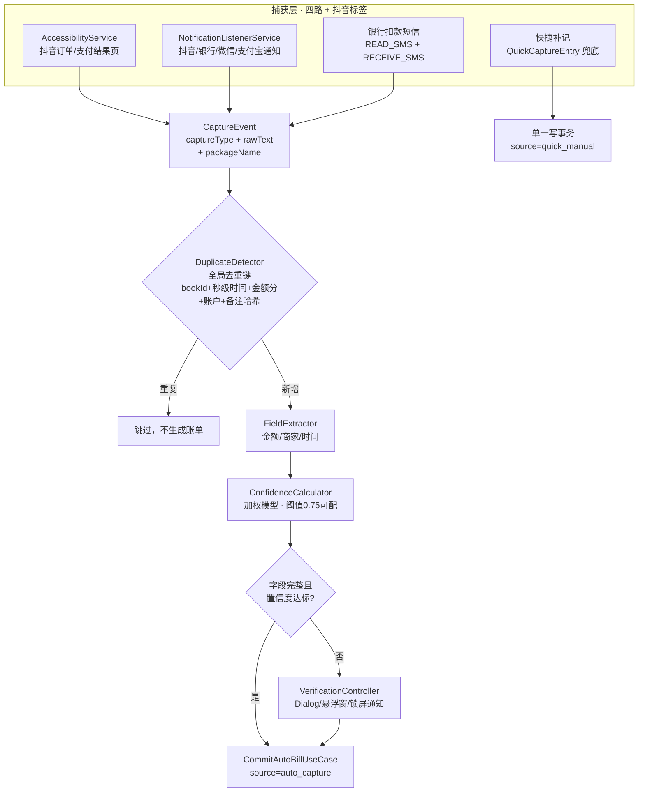

# 增量 PRD：抖音快捷支付识别与快捷输入接口（第 23 章）

| 项目 | 内容 |
| --- | --- |
| 文档版本 | V1.2（增量） |
| 需求来源 | 用户追加原话：「同时添加抖音快捷支付的识别方法，目前抖音免密支付无感，还要有用户快捷打开软件输入消费的接口」 |
| 基线文档 | `01_整合PRD.md`（第 22 章）、`02_系统架构设计.md`（T1~T5、`CaptureEvent`、`DuplicateDetector`、置信度模型） |
| 文档范围 | **仅本次变更（增量）**，不重复第 1~22 章；与既有章节的关系见 23.0 |
| 目标平台 | Android 原生 Kotlin（V1 唯一交付平台）；本地优先、离线 |
| 目标用户 | 阿祖（本人），北京，C++/Qt 3 年经验，资深工程师——结论先行、证据链完整、不粉饰限制 |

> **结论先行**：用户描述的「抖音免密支付无感」在标准 Android 沙盒内**无法做到实时、零副产物检测**（见 23.1.1，❌ 明确写死）。可落地的是「多源捕获 + 统一去重 + 低置信度校对 + 一键补记」组合（见 23.1.2~23.1.5、23.2）。

---

## 23.0 与第 22 章的关系（先定位，再展开）

| 维度 | 第 22 章已有 | 本增量（第 23 章）新增 | 关系 |
| --- | --- | --- | --- |
| 捕获源 | 读屏 / 截屏 / 通知 3 路 | **+ 银行扣款短信**（第 4 路）；抖音作为「业务来源」贯穿各路 | 复用同一 `CaptureEvent` 抽象，**不另起管线** |
| 去重 | 8.2 + 22.9：`DuplicateDetector`，全局键 = bookId + 秒级时间 + 金额分 + 账户 + 备注哈希 | 短信源**新增时间容差窗口**（±180s）以覆盖短信延迟到达 | 复用同一算法，扩展键的比较策略 |
| 分类与置信度 | 22.4/22.9 + 架构 5.3：加权模型（6 因子，阈值 0.75 可配），未命中归「其他支出」 | **抖音种子规则**注入 `CategoryRuleEntity`；文本源（短信/通知）适配 OCR 因子 | 复用 `ConfidenceCalculator.calculate`，不改分母 |
| 校对 | 22.4 d 三档弹窗（Dialog / 悬浮窗 / 锁屏通知） | 不变；短信解析失败、抖音规则未命中均接入既有弹窗 | 完全复用 |
| 权限 | 无障碍 / 通知使用权 / 悬浮窗 / FGS / 通知权限 / MediaProjection 等 | **+ READ_SMS / RECEIVE_SMS**；快捷入口复用悬浮窗与 FGS 通知权限 | 见 23.3.2 |
| 快捷入口 | 无 | 4 个入口统一走 `QuickCaptureEntry` 契约 → 单一写事务 | 新增，但不动 T1+T2 地基（见 23.3.3） |

---

## 23.1 抖音免密支付识别

### 23.1.1 结论先行：真·无感扣款（无通知 + 无 UI 变化 + 无短信）**做不到**

| 项 | 内容 |
| --- | --- |
| 可行性 | ❌ **标准 Android 系统内无法实现实时检测** |
| 用户场景 | 抖音免密支付在**本机不产生任何 UI 变化、不产生通知、不产生短信**，仅抖音服务器与支付渠道服务器完成后台代扣 |
| 证据链 1 | **应用沙盒隔离**：Android 应用间数据不可互读；系统不存在「全局交易事件 / 全局扣款广播」供第三方 App 订阅 |
| 证据链 2 | **AccessibilityService 只能读当前屏幕的 UI 节点**：无 UI 变化 → 无节点可读 → 无信号 |
| 证据链 3 | **NotificationListenerService 只能读通知栏**：无通知 → 无内容可读 → 无信号 |
| 证据链 4 | **READ_SMS 只能读短信**：无短信 → 无内容可读 → 无信号 |
| 证据链 5 | **无 hook 能力**：非 root / 系统签名 / Xposed，无法拦截抖音支付 SDK 内部流程或读取其本地状态（与第 22.3 第 4/5 条同源限制） |
| 可落地边界 | 覆盖「**有副产物**」的支付：有 UI（订单页/支付结果页）、有通知、有银行扣款短信。三者皆无时**无法实时检测**，只能由用户在 App 内手动补记或对账时发现 |
| 产品处理 | 设置页与「自动化能力说明」中**固定文案如实告知**，不承诺无感检测；提供一键快捷补记作为兜底（23.2） |

### 23.1.2 多源捕获方案（可落地部分，四路总览）

| # | 捕获源 | 覆盖场景 | 关键权限 | 判定规则要点 | 落地优先级 |
| --- | --- | --- | --- | --- | --- |
| 1 | **AccessibilityService 读屏** | 抖音有 UI 的支付：订单页、支付结果页、抖音商城结算页 | 无障碍服务（第 22.6 已有） | 监听抖音包名窗口变化 → 抓取含「支付成功 / 已支付 / 订单号 / ¥金额 / 商家」的文字节点；`packageName` 命中抖音即打业务标签 | P0 |
| 2 | **NotificationListenerService** | 抖音支付通知、银行/微信/支付宝代扣通知 | 通知使用权（第 22.6 已有） | 按包名 + 关键词过滤；「支付成功/扣款/支出」类通知解析金额、商家、时间 | P0 |
| 3 | **银行扣款短信监听（本次新增）** | 无 UI、无通知，但**有银行扣款短信**的免密代扣——补上无感缺口的关键来源 | READ_SMS + RECEIVE_SMS（新增） | 发件人银行号白名单 + 正文扣款关键词 + 金额正则；本地解析，详见 23.1.3 | **P0（关键）** |
| 4 | **用户手动快捷补记** | 三路皆无副产物的真·无感扣款 | 无（或复用悬浮窗权限） | 用户一键拉起表单预填补记，见 23.2 | P0（兜底） |

> 截屏路（MediaProjection）沿用第 22 章备选能力，抖音支付结果页若需 OCR 可直接复用，不作为本增量新增能力。

### 23.1.3 银行扣款短信监听（新增关键源）

#### 权限与获取方式

| 权限 | 用途 | 申请方式 | 说明 |
| --- | --- | --- | --- |
| `READ_SMS` | 读取短信正文（历史 + 新到） | 危险权限，运行时申请；设置页说明「仅用于识别支付扣款短信，本地解析不上传」 | 个人自用、不上架（决策 D-02），可申请 |
| `RECEIVE_SMS` | 实时接收新短信广播 | Manifest 声明 + 运行时 READ_SMS 授权后生效 | 三方 App 可接收有序广播；本应用**不设为默认短信 App** |
| `SMS_RETRIEVER` | ⚠️ **不作为主路径** | — | SMS Retriever API 依赖 App 签名哈希、定位于**验证码一次性读取**，无法覆盖通用银行扣款短信；仅当未来对接特定机构结构化短信时再评估 |

#### 短信解析规则（本地正则 + 关键词，不联网）

| 环节 | 规则 | 失败处理 |
| --- | --- | --- |
| 发件人过滤 | 银行官方短号白名单（95588 工行、95533 建行、95566 中行、95559 交行、95511 平安、95561 兴业、95558 中信、95595 光大等）+ 含「银行/Bank/Credit」的 alpha sender；可扩展 | 非白名单发件人丢弃（不落入 CaptureEvent） |
| 业务类型过滤 | 命中「支出/扣款/消费/交易/支付/转出」之一；**排除**「验证码/营销/退款/返还/收入/存入/还款入账」 | 排除类直接丢弃，避免误记账 |
| 金额提取 | 正则 `¥?[\d,]+\.\d{2}` 或「人民币(\d+)元」；去千分位、转「分」存储 | 无金额 → 视为解析失败，走低置信度弹窗 |
| 时间提取 | 优先正文时间（`yyyy-MM-dd HH:mm` / `MM月dd日 HH:mm`）；无则取短信到达时间戳 | 无正文时间时标记 `timeSource=SMS_ARRIVAL`，置信度略降 |
| 商家提取 | 正则「商户/交易对手/收款方[:：]\s*([^\s,，。]+)」；无则取「银行扣款-<银行简称>」 | 商家为空 → 强制校对 |
| 账户映射 | 发件人银行号 → `AccountEntity`（储蓄卡/信用卡）；未命中归默认账户并降置信度 | 走 22.10「账户未命中」处理 |
| 抖音标签 | 正文含「抖音/抖音支付/抖音商城/巨量引擎」→ 打抖音业务标签，注入分类种子规则（23.1.5） | 未命中不影响入账 |

#### 隐私保护（对应第 17 章）

- **本地解析、不上传**：短信正文不联网、不写入日志、不进入云同步与备份明文。
- **最小留存**：仅将结构化字段（金额、时间、商家、银行简称、脱敏后四卡号）写入加密的 `CaptureEvent`；短信原文不落库。
- **用户可控**：设置页提供「短信识别」总开关，可一键关闭并撤销权限；关闭后该源停用，其余源继续工作，不崩溃。
- **权限用途说明**：申请弹窗前先用应用内卡片说明用途与边界，符合 D-02「不静默获取」。

### 23.1.4 统一汇入第 22 章管线（不另起炉灶）

**所有捕获源（含短信、抖音读屏/通知）统一产出 `CaptureEvent`，经 `DuplicateDetector` 去重后进入同一识别与校对流程。**

#### 去重时间容差（本增量关键规则）

| 规则 | 说明 |
| --- | --- |
| 默认键 | 复用 8.2/22.9：同一账本 + 秒级时间 + 相同金额 + 相同账户 + 相同备注 → 重复 |
| **短信容差** | 银行短信常在支付后数秒~数分钟到达；短信源对 `billTime` 采用 **±180s（可配）** 的时间容差参与去重匹配，避免与读屏/通知路同一笔因时间差漏去重 |
| 迟到补偿 | 短信晚到时，以容差窗口回查已入账记录；命中则丢弃该 `CaptureEvent`，不产生第二条账单 |
| 时间取值优先级 | 正文交易时间 > 短信到达时间；使用到达时间时标记低置信度 |
| 幂等 | 同一 `CaptureEvent` 无论被几路捕获，写库前必须过 `DuplicateDetector`；快捷补记（A4）亦走单一写事务兜底 |

### 23.1.5 抖音种子规则与置信度接入

#### 种子关键词（写入 `CategoryRuleEntity`，可增删改）

| 类别 | 关键词 | 映射目标 |
| --- | --- | --- |
| 抖音业务识别 | 抖音支付、抖音、抖音商城、巨量引擎、douyin、aweme | 打「抖音」业务标签；`packageName=com.ss.android.ugc.aweme` 亦作为强信号 |
| 支付结果确认 | 支付成功、已支付、付款成功、交易成功、订单号 | 提升「支付已发生」判定置信度 |
| 金额/商家上下文 | ¥、元、收款方、商户名称、订单金额 | 辅助 FieldExtractor 抽取 |
| 账户映射 | （由银行短信发件人映射AccountEntity） | 命中账户因子 |

> 规则引擎复用第 22 章既有 `CategoryRuleEntity`（keyword / categoryId / priority / enabled），抖音规则以 `priority` 高于通用规则注入，**不新增规则表**。

#### 接入既有加权置信度模型（分母不变，见架构 5.3）

| 因子 | 原权重 | 抖音/短信场景计分 |
| --- | --- | --- |
| OCR 引擎置信度 | 0.30 | **文本源（读屏/通知/短信）直接取满值 1.0**（系统直出文字，无 OCR 误差）；图像源仍取 ML Kit block.confidence 均值 |
| 金额合法 | 0.25 | 金额命中正则且 >0 → 1 |
| 时间可解析 | 0.15 | 正文时间命中 → 1；仅短信到达时间 → 酌减 |
| 商家非空 | 0.10 | 非空 → 1；空 → 0 且强制校对 |
| 分类规则命中 | 0.15 | **抖音种子关键词命中 → 1**；未命中归「其他支出」并扣 0.15（通常触发弹窗） |
| 账户匹配 | 0.05 | 银行号/抖音包名映射成功 → 1 |

- `needVerify` 判定沿用架构 5.3：金额/时间/商家任一缺失 → 强制弹窗；`finalScore < threshold(默认0.75)` → 弹窗。
- 分类目标：抖音支付默认映射「购物」或用户自定义「抖音」分类（可在设置中指定），命中失败按第 22 章默认「其他支出」处理。

---

## 23.2 用户快捷打开软件输入消费的接口

**目标**：识别不到抖音无感支付时，用户一键打开 App 并预填信息完成补记；同时提供日常快捷记账入口。

### 23.2.1 四类入口总览

| # | 入口 | 触发方式 | 依赖权限 | 是否新增权限 |
| --- | --- | --- | --- | --- |
| 1 | **App Shortcut** | 长按桌面图标 →「记一笔」 | 无（Launcher 能力） | 否 |
| 2 | **桌面小组件 AppWidget** | 点击桌面组件「记一笔」；组件显示今日已记/预算余额 | 无（Glance 组件，数据来自 T2 Repository） | 否 |
| 3 | **悬浮窗快捷球** | 任意界面点击悬浮球拉起记账 | `SYSTEM_ALERT_WINDOW`（**复用**第 22.6 悬浮窗权限） | 否 |
| 4 | **常驻前台服务通知** | 点击 FGS 常驻通知的「记一笔」动作 | FGS + `POST_NOTIFICATIONS`（**复用**第 22.6） | 否 |

> 四个入口**不各自造写入逻辑**，统一走 23.2.3 的 `QuickCaptureEntry` 契约。

### 23.2.2 各入口交互流程

| 入口 | 交互流程 | 备注 |
| --- | --- | --- |
| App Shortcut | 长按图标 → 点「记一笔」→ 携带 `entry=APP_SHORTCUT` 拉起记账表单（无预填则空表单） | 静态 shortcut 定义即可；动态可选 |
| AppWidget | 展示「今日已记 X 笔 / 预算余额 Y」；点击 → `entry=APP_WIDGET` 拉起表单；数据定时刷新 | 聚合数据复用 T2，不改数据层骨架 |
| 悬浮球 | 授权悬浮窗后常驻，可拖拽/收起；点击 → `entry=FLOATING_BALL` 拉起表单 | 与第 22 章「低置信度校对弹窗」共用同一悬浮窗权限，权限引导页说明双重用途 |
| FGS 通知 | 常驻通知增加「记一笔」PendingIntent → `entry=FG_NOTIFICATION` 拉起表单 | 复用第 22 章前台服务，无新服务 |

### 23.2.3 快捷记账接口契约 `QuickCaptureEntry`（内部 API，架构师据此设计签名）

#### 入参

| 参数 | 类型 | 必填 | 说明 |
| --- | --- | --- | --- |
| `entry` | enum | 是 | `APP_SHORTCUT` / `APP_WIDGET` / `FLOATING_BALL` / `FG_NOTIFICATION` / `DouyinFallback`（抖音识别失败兜底） |
| `source` | enum | 是（固定） | `quick_manual`（区别于 `auto_capture` / `manual` / `import`） |
| `amountFen` | Long? | 否 | 预填金额（分）；抖音识别失败时可由捕获事件带入 |
| `merchant` | String? | 否 | 预填商家/备注 |
| `billTime` | Long? | 否 | 预填时间戳（ms）；默认当前时间 |
| `bookId` / `accountId` / `categoryId` | Long? | 否 | 预填账本/账户/分类；默认取设置项与规则匹配结果 |
| `fromCaptureEventId` | Long? | 否 | 抖音/短信识别失败兜底时带入，用于关联来源并避免重复提醒；确认入账后标记该事件为 `user_corrected` |

#### 行为契约

| 行为 | 规定 |
| --- | --- |
| 拉起 | 打开 MainActivity → 第 7 章记账表单，按入参预填；未传字段留空/取默认 |
| 保存 | 用户点保存 → **走与手动记账完全相同的单一 `@Transaction` 写入口**（复用 T2 `CommitManualBillUseCase`），不新增写库路径；`source=quick_manual` |
| 取消 | 用户返回/取消 → 不写库，清理预填状态，不产生残留记录 |
| 幂等 | 同一 `fromCaptureEventId` 重复点击不重复建单；保存时仍由 `DuplicateDetector` 兜底 |
| 校验 | 金额必填且 >0，否则表单内校验拦截，与第 7 章一致 |
| 统计 | 快捷入口来源记入埋点/本地统计（可选），用于优化入口，不影响账单字段结构 |

### 23.2.4 与「抖音无感支付兜底」的关系

- 当抖音免密支付**无任何副产物**（23.1.1）或三路+短信均解析失败（低置信度弹窗用户仍无法补全）时，弹窗提供「**一键补记**」按钮 → 携带 `entry=DouyinFallback` + 已知预填字段调用 `QuickCaptureEntry`。
- 用户补记后账单 `source=quick_manual`，`fromCaptureEventId` 关联原捕获事件并标记 `user_corrected`，避免后续重复提醒。
- 定位：自动化能力覆盖不到的部分，用最短路径把用户手动成本降到最低，而非承诺不存在的自动检测。

---

## 23.3 影响分析

### 23.3.1 对现有章节的影响

| 章节 | 影响 | 处理 |
| --- | --- | --- |
| 第 4 章 数据字段 | 需区分短信源、抖音来源、快捷入口来源 | 见下方「字段模型建议」；默认**零新增列**，仅扩展枚举/规则数据 |
| 第 17 章 隐私安全 | 新增短信读取 | 承诺本地解析、不上传、不落原文、可一键关闭并撤销权限（23.1.3） |
| 第 19 章 异常与错误处理 | 新增短信权限被拒、短信解析失败、抖音规则未命中场景 | 显式提示 + 降级，不静默失败（23.3.1 下表） |
| 第 22 章 自动化 | 新增第 4 捕获源（短信）、抖音种子规则、去重时间容差、文本源置信度适配 | 全部复用现有 `CaptureEvent` / `DuplicateDetector` / `ConfidenceCalculator`，不改架构骨架 |
| 第 7 章 手动记账 | 快捷入口复用记账表单 | 表单需支持外部预填入参，写入口不变 |
| 第 15 章 筛选 | 来源筛选新增 `quick_manual` | 与 `auto_capture` 一并纳入来源筛选 |

#### 字段模型建议（回应 team-lead 关于 `capture_source=sms/douyin/shortcut` 的提问）

| 维度 | 现有取值 | 建议 | 理由 |
| --- | --- | --- | --- |
| 账单 `source`（4.1） | manual / import / auto_capture | **+ `quick_manual`** | 快捷入口补记属手动性质，单列来源便于统计；不新增 `sms/douyin/shortcut` 到账单级 |
| 捕获事件 `captureType`（4.2） | accessibility_text / projection_image / notification | **+ `sms`** | 短信是真正的新捕获类型；抖音读屏/通知复用现有类型 + `packageName` 标识，**不新增 `douyin` 枚举**，避免枚举膨胀 |
| 抖音业务标签 | 无 | 由 `packageName` + 种子关键词识别，落在 `CategoryRuleEntity` 与 `ocr_raw_text` | 业务标签 ≠ 捕获类型，用规则层表达 |
| 快捷入口来源 | 无 | `QuickCaptureEntry.entry` 枚举，仅用于埋点/关联，**不写账单表** | 入口维度与账单维度解耦 |
| 关联字段 | 无 | **可选** `fromCaptureEventId`（可空列，向后兼容）；架构师可不新增列，改用事件查询关联 | 默认零 schema 变更，保护 T2 地基 |

#### 新增异常场景（并入第 19 章规范）

| 场景 | 处理 | 是否静默 |
| --- | --- | --- |
| 短信权限被拒 / 被系统回收 | 关闭短信源，设置页红点 + 引导；其余捕获源继续工作 | 否，显式提示 |
| 短信正文无法解析（金额/时间缺失） | 生成低置信度 `CaptureEvent` → 走 22.4 d 弹窗校对 | 否 |
| 验证码/营销短信误入 | 白名单 + 排除关键词过滤；用户可标记「忽略此类短信」 | 否（过滤时不提示，标记时反馈） |
| 抖音 App 版本更新导致 UI 节点变化 | 读屏规则可配置；连续 N 次失败降级为通知/短信源并提示用户 | 否 |
| 短信迟到导致与读屏/通知重复 | `DuplicateDetector` ±180s 容差拦截 | 是（正确去重，无需打扰用户） |

### 23.3.2 新增权限清单

| 权限 | 用途 | 是否必需 | 申请方式 | 缺失降级 |
| --- | --- | --- | --- | --- |
| `READ_SMS` | 读取银行扣款短信（抖音无感缺口关键源） | 可选（强烈建议） | 运行时申请，前置应用内用途说明卡片 | 关闭短信源，仅靠读屏/通知 + 快捷补记 |
| `RECEIVE_SMS` | 实时接收新短信广播 | 可选（配合 READ_SMS） | Manifest 声明 | 退化为按需读取已有短信 |
| `SYSTEM_ALERT_WINDOW` | 悬浮球快捷入口 + 第 22 章校对弹窗 | 可选（复用） | 第 22.6 已申请，本增量不重复 | 悬浮球隐藏，其余入口可用 |
| `FOREGROUND_SERVICE` / `POST_NOTIFICATIONS` | FGS 常驻通知「记一笔」 | 必需（复用） | 第 22.6 已申请 | 该入口不可用，其余入口可用 |
| App Shortcut / AppWidget | 桌面入口 | **无新增权限** | Launcher/Glance 标准能力 | — |

### 23.3.3 对任务批次的影响（明确：不影响 T1+T2 地基）

| 任务批次 | 是否受影响 | 说明 |
| --- | --- | --- |
| T1 项目基础设施 | ❌ 不受影响 | 无新增模块/第三方依赖；短信走 Framework API |
| T2 数据层与领域层 | ❌ 地基不受影响 | 默认零 schema 变更：抖音用规则数据、短信用 `captureType` 枚举扩展、`quick_manual` 用现有 `source` 枚举；可选可空列 `fromCaptureEventId` 由架构师定，不改主键与事务边界 |
| T3 基础功能 UI | ⚠️ 轻微 | 记账表单支持外部预填入参 |
| T4 其他功能 | ❌ 不受影响 | — |
| **T5 智能自动化** | ✅ **主要落点** | 新增短信捕获源、抖音种子规则、去重容差、文本源置信度适配、限制告知文案 |
| **UI 批次** | ✅ **主要落点** | 4 个快捷入口、设置页「短信识别」开关与权限引导卡片、抖音能力说明 |

> 交付建议：本增量由工程师在 **T5 与 UI 批次**实现，T1+T2 地基任务无需返工；若架构师评估后决定新增可空列，作为 T2 的小幅兼容扩展，不阻塞已开工任务。

### 23.3.4 新增验收标准（接第 22.11，从 AC-11 起）

| 编号 | 验收项 | 通过条件 |
| --- | --- | --- |
| AC-11 | 抖音短信识别 | 授权 READ_SMS 后，典型银行扣款短信可提取金额/时间/商家/账户并生成账单；含「抖音」关键词时打业务标签 |
| AC-12 | 抖音读屏/通知识别 | 抖音订单/支付结果页与支付通知可被捕获并生成账单；规则未命中按「其他支出」并弹窗 |
| AC-13 | 无感支付限制告知 | 应用内明确说明「无 UI + 无通知 + 无短信时无法实时检测」，不出现误导性承诺 |
| AC-14 | 快捷入口拉起与预填 | 4 个入口均能拉起记账表单；传入预填字段正确显示；取消不写库；确认走单一 `@Transaction` 写事务且 `source=quick_manual` |
| AC-15 | 权限复用 | 悬浮球与第 22 章校对弹窗共用悬浮窗权限，不重复申请；FGS 通知入口复用常驻服务 |
| AC-16 | 去重不冲突 | 抖音读屏/通知/短信三路捕获同一笔仅生成一条账单；短信迟到（±180s 内）不产生重复；补记后捕获事件标记 `user_corrected` 不再提醒 |
| AC-17 | 短信隐私与降级 | 短信本地解析不上传、不落原文；关闭开关/撤销权限后功能降级不崩溃，其他源正常 |
| AC-18 | 置信度接入 | 文本源 OCR 因子按满值计；抖音关键词命中使分类因子满分；字段缺失强制弹窗，阈值行为与 22.11 AC-2 一致 |

---

## 23.4 待确认事项（Open Questions，不阻塞 T1~T5）

| 编号 | 问题 | 默认假设 | 决策方 |
| --- | --- | --- | --- |
| Q-DY-1 | 抖音支付默认分类映射 | 映射「购物」，用户可在设置中改为自定义「抖音」分类 | 阿祖 |
| Q-DY-2 | 短信去重容差 180s 是否合适 | 先按 180s 实现，DataStore 可配 | 阿祖 / 架构师 |
| Q-DY-3 | 是否新增可空列 `fromCaptureEventId` | 默认不新增，用事件查询关联；如需强关联再加列 | 架构师 |
| Q-DY-4 | 悬浮球默认开启还是默认关闭 | 默认关闭，设置页引导开启（避免打扰） | 阿祖 |

---

> **交付说明**：本增量 PRD 仅描述第 23 章变更，与 `01_整合PRD.md` 第 22 章、`02_系统架构设计.md` T5 配套使用。核心结论：真·无感扣款做不到（❌ 已给证据链）；可落地方案为「读屏 + 通知 + 银行短信 + 手动快捷补记」四路捕获，统一汇入既有 `CaptureEvent` → `DuplicateDetector` → 加权置信度 → 三档校对管线；增量主要落在 T5 与 UI 批次，不触动 T1+T2 地基。
