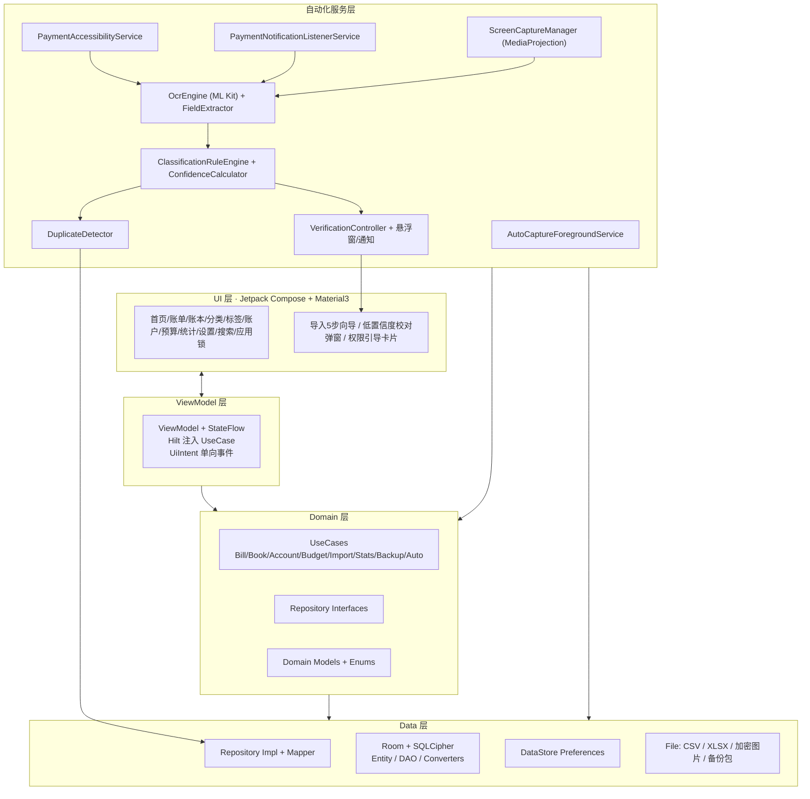
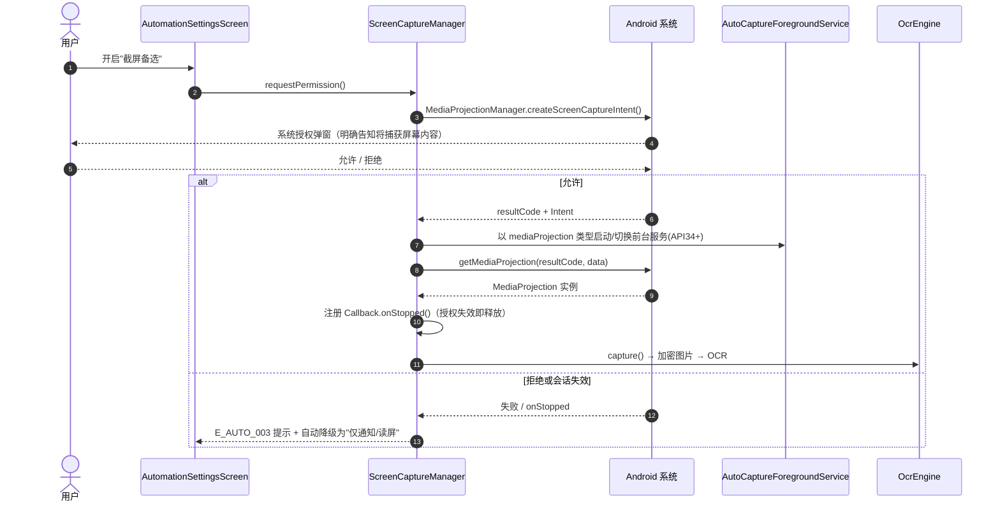
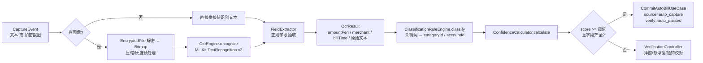
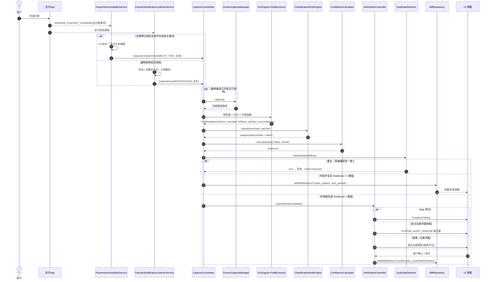
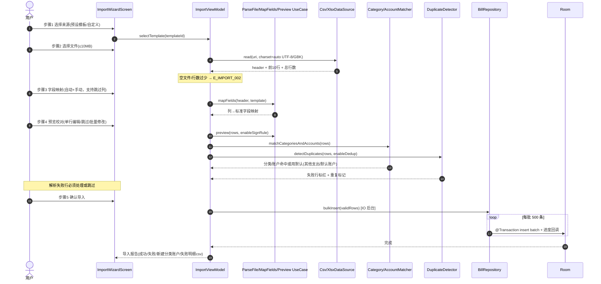
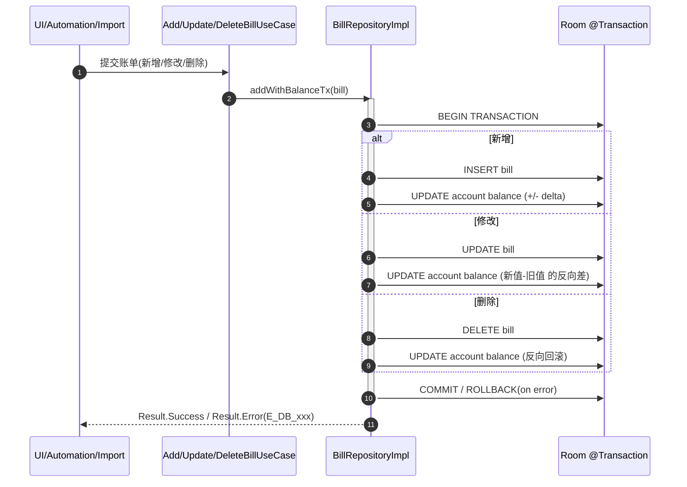
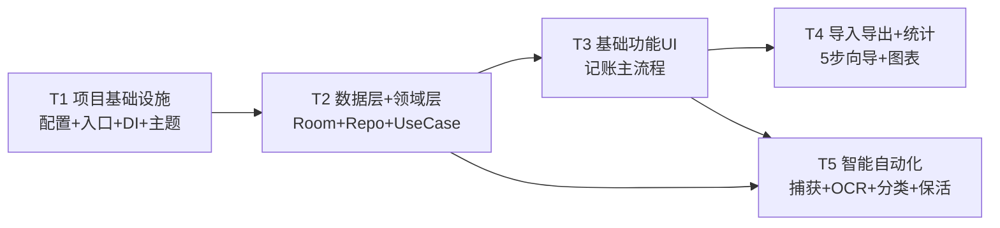

# 记账 App 系统架构设计 + 任务分解

| 项目 | 内容 |
| --- | --- |
| 文档版本 | V1.0（架构基线） |
| 上游输入 | `01_整合PRD.md`（V1.1 整合版，459 行）+ `00_原始需求_PRD_V1.0.md` |
| 交付目标 | Android 原生 Kotlin 个人自用记账 App（本地优先 + 智能自动化记账） |
| 技术栈基线 | Kotlin / Room+SQLCipher / ML Kit 离线 OCR / Hilt / Coroutines+Flow / Jetpack Compose |
| 设计约束 | minSdk 26（Android 8.0）；标准 Android 沙盒（无 root / 系统签名 / Xposed）；不上架 |
| 阅读对象 | 工程师（批量写代码）、QA（验收依据）、主理人（决策审阅） |

---

## 目录

- [1. 实现方案与技术选型](#1-实现方案与技术选型)
- [2. 分层架构图](#2-分层架构图)
- [3. 完整文件清单](#3-完整文件清单)
- [4. 数据结构与接口（类图）](#4-数据结构与接口类图)
- [5. 自动化模块详细设计（本次重点）](#5-自动化模块详细设计本次重点)
- [6. 关键流程时序图](#6-关键流程时序图)
- [7. 任务列表（有序、含依赖）](#7-任务列表有序含依赖)
- [8. 依赖包列表（Gradle 坐标）](#8-依赖包列表gradle-坐标)
- [9. 共享知识 / 跨文件约定](#9-共享知识--跨文件约定)
- [10. 待明确事项](#10-待明确事项)

---

## 1. 实现方案与技术选型

### 1.1 核心技术难点与破解思路（结论先行）

| # | 难点 | 证据 / 约束来源 | 架构破解思路 |
| --- | --- | --- | --- |
| N1 | 三路捕获（读屏 / 截屏 / 通知）会重复生成同一笔账单 | PRD 22.9、AC-6 | 统一 `CaptureEvent` 抽象 + **全局去重键**（bookId + 秒级时间 + 金额分 + 账户 + 备注哈希），在写库前由 `DuplicateDetector` 统一拦截，与导入去重共用同一算法 |
| N2 | 后台保活与系统强杀限制 | PRD 22.3 第 4 条（❌）、22.4 a | 前台服务 + 常驻通知 + 厂商白名单引导 + `RECEIVE_BOOT_COMPLETED` + WorkManager 周期性探活；**强杀自启明确不做**，设置页如实告知 |
| N3 | OCR 字段抽取准确率与误分类 | PRD 22.3 第 1 条、AC-1/AC-2 | ML Kit 离线 OCR → 正则字段抽取 → 关键词规则引擎 → **加权置信度模型** → 低于阈值强制人工校对闭环 |
| N4 | 余额一致性（手动 / 导入 / 自动 / 编辑 / 删除多写入口） | PRD 第 9、12、8.2 章 | **单一写入口**：所有创建/修改/删除必须经 `BillRepository` 的 @Transaction 方法驱动余额增减，禁止 UI 直接写 Account 表 |
| N5 | 1 万条导入 < 10s 且不卡 UI | PRD 第 20 章、8.1 步骤 5 | 流式逐行解析（不整载入内存）+ 分批事务（500 条/批）+ Coroutines `IO` 调度 + Flow 进度回调 |
| N6 | 账单与捕获图像加密存储 | PRD 第 17 章、22.9 | Room 走 SQLCipher（透明加密）；截图文件走 `EncryptedFile`(AES/GCM + Android Keystore)；设置页一键清除 |
| N7 | 权限碎片化（无障碍 / 通知使用权 / 悬浮窗 / 电池 / 厂商） | PRD 22.6、AC-7 | 统一 `PermissionGuide` 状态机 + 设置页权限卡片 + 红点引导；每个权限有用途说明与跳转 Intent，缺失显式提示不静默 |

### 1.2 技术选型表（逐项给理由）

| 领域 | 选型 | 版本基线 | 理由（面向资深工程师） |
| --- | --- | --- | --- |
| 语言 / 平台 | Kotlin + Gradle Kotlin DSL | Kotlin 2.0.x | PRD 固化；空安全 + 协程原生友好；Kotlin DSL 与 Version Catalog 统一依赖管理 |
| 最低版本 | minSdk 26 / targetSdk 35 | — | PRD 第 20 章；API 26 起 `startForegroundService` 可用，API 34+ 需 FGS 类型声明 |
| **UI 框架** | **Jetpack Compose + Material 3**（不用 XML） | Compose BOM 2024.09.x | ① 本项目全新工程、无历史 XML 包袱；② 导入 5 步向导、低置信度校对弹窗、筛选面板都是**重状态 UI**，Compose 的 `StateFlow.collectAsState` + 重组模型比 XML 的 `findViewById/ViewBinding` + 手动刷状态代码量少一个量级；③ 与 Flow / Hilt / Navigation Compose 端到端一致；④ 图表通过 `AndroidView` 包装成熟 View 库即可，不构成阻碍。**取舍**：放弃 XML 的预览成熟度与部分第三方 View 生态，换取长期可维护性 |
| 图表 | **MPAndroidChart**（`AndroidView` 包装） | v3.1.0 | 必须同时支持饼图（支出/收入）、柱状/折线趋势、点击下钻。MPAndroidChart 的 `OnChartValueSelectedListener` 下钻能力最成熟；Vico 2.x 的 Compose 饼图较新、风险高。备选 `compose-charts`，但社区规模与稳定性不如前者 |
| DI | **Hilt** | 2.51.1 | 官方标准，与 `@ViewModelInject`/`navigation-compose`/`WorkManager` 集成完备；避免手写 ServiceLocator 在 Service/BroadcastReceiver 场景的注入混乱 |
| 异步 | Coroutines + Flow / StateFlow | 1.8.1 | 数据库观察、进度回调、后台服务事件流统一；`flatMapLatest` 处理搜索防抖 |
| 本地数据库 | **Room + SQLCipher** | Room 2.6.1 / SQLCipher 4.5.5 | Room 提供编译期 SQL 校验与 Flow 观察；SQLCipher 以 `SupportFactory` 注入实现透明加密，满足"加密存储"且对 DAO 层零侵入 |
| KV 配置 | DataStore Preferences | 1.1.1 | 替代 SharedPreferences（异步、Flow、无 ANR）；存放默认账本、OCR 阈值、自动化开关 |
| 后台任务 | WorkManager + 前台服务 | 2.9.1 | 备份、周期账单、服务探活交给 WorkManager（系统约束下可靠）；实时捕获链路走前台服务（低延迟） |
| 导航 | Navigation Compose | 2.7.7 | 与 Compose 原生一致，参数用 sealed `Screen` 路由集中定义 |
| **OCR** | **ML Kit Text Recognition v2**（`com.google.mlkit:text-recognition`） | 16.0.1 | PRD 明确要求离线；v2 模型比 v1 准确率高且支持 Latin（金额数字）；模型随 APK/Play 下发，**推理全程本地不联网**，满足 AC-9 |
| CSV 解析 | **kotlin-csv-jvm** | 1.9.3 | 纯 Kotlin、流式逐行 API、可指定 `Charset`（UTF-8 / GBK 自动识别）；比 commons-csv 更贴合协程分批处理 |
| XLSX 解析 | **Apache POI `poi-ooxml-lite`** | 5.2.5 | XLSX 是次优先级格式；lite 版剔除 xmlbeans，规避 Android 运行期 XML 解析冲突；仅在导入/导出模块按需加载 |
| 图片加载 | Coil Compose | 2.6.0 | Compose 原生、轻量，用于小票 / 账户图标 |
| 序列化 | Kotlinx Serialization JSON | 1.6.3 | 备份包 / 导出配置用；Kotlin 原生无反射，比 Gson 更适合 R8 |
| 加密文件 | `androidx.security:security-crypto`（EncryptedFile） | 1.1.0-alpha06 | 官方 AES/GCM + Keystore 封装，用于捕获截图加密落盘；`KEY` 由系统 Keystore 托管 |
| 时间日期 | `java.time` + coreLibraryDesugaring | desugar 2.0.4 | API 26 无原生 java.time；开启 desugaring 后统一用 `Instant`/`LocalDateTime`，避免引入 Joda-Time |
| 日志 | Timber | 5.0.1 | 统一日志门面，release 可关闭；自动化服务排障必需 |
| 测试 | JUnit4 + MockK + Turbine + Compose Test | — | ViewModel 用 Turbine 测 Flow，Repository 用 MockK，UI 用 Compose `createComposeRule` |

### 1.3 架构模式

采用 **MVVM + Clean Architecture（单向依赖）**：

```
UI(Compose) → ViewModel(StateFlow/Intent) → Domain(UseCase → Repository 接口) → Data(Repository 实现 → Room/DataStore/File)
                                                    ↑
                                           Automation 服务层（作为 Domain 的"生产者"，只依赖 Domain 接口）
```

- **UI 不直接持有 Repository**，只依赖 UseCase。
- **Automation 服务层与 UI 层平级**，二者通过 `BillRepository` 接口 + `VerificationController`（事件总线）解耦：服务不引用 Activity，弹窗通过 `VerificationController` 发出的 `SharedFlow` 由 UI 收集。
- **领域模型与 Entity 分离**：Room Entity 只在 Data 层流动，Domain 层用纯 Kotlin data class，mapper 单向转换。

---

## 2. 分层架构图



**依赖方向铁律**：L1 → L2 → L3 → L4；L5 只依赖 L3/L4，**绝不 import 任何 `ui.*` 类**。跨层通信用接口 + Flow。

---

## 3. 完整文件清单

> 相对路径基线：`/Users/gt/WorkBuddy/spaces/2026_11_22_11-39-32/bookkeeper-app/`
> 根包名：`com.azu.bookkeeper`

### 3.1 工程配置与入口

```
settings.gradle.kts
build.gradle.kts                                  # 根构建脚本（插件版本）
gradle.properties
gradle/libs.versions.toml                         # Version Catalog（唯一依赖版本源）
app/build.gradle.kts
app/proguard-rules.pro
app/src/main/AndroidManifest.xml                  # 全量组件声明（Service/Receiver/权限）
app/src/main/res/values/colors.xml
app/src/main/res/values/themes.xml
app/src/main/res/values/strings.xml
app/src/main/res/xml/accessibility_service_config.xml
app/src/main/res/xml/file_paths.xml
app/src/main/res/xml/backup_rules.xml
app/src/main/res/mipmap-anydpi-v26/ic_launcher.xml
```

### 3.2 core（全局约定 / DI）

```
app/src/main/java/com/azu/bookkeeper/core/Constants.kt
app/src/main/java/com/azu/bookkeeper/core/Result.kt              # sealed Result<out T>
app/src/main/java/com/azu/bookkeeper/core/AppError.kt            # 错误码枚举 + 用户文案
app/src/main/java/com/azu/bookkeeper/core/Money.kt               # 分单位换算与格式化
app/src/main/java/com/azu/bookkeeper/core/DateTimeUtils.kt
app/src/main/java/com/azu/bookkeeper/core/Extensions.kt
app/src/main/java/com/azu/bookkeeper/core/di/AppModule.kt
app/src/main/java/com/azu/bookkeeper/core/di/DispatcherModule.kt
app/src/main/java/com/azu/bookkeeper/core/di/DatabaseModule.kt   # Room + SQLCipher SupportFactory
app/src/main/java/com/azu/bookkeeper/core/di/RepositoryModule.kt
app/src/main/java/com/azu/bookkeeper/core/di/AutomationModule.kt
app/src/main/java/com/azu/bookkeeper/BookkeeperApp.kt            # @HiltAndroidApp
app/src/main/java/com/azu/bookkeeper/MainActivity.kt            # @AndroidEntryPoint, setContent
```

### 3.3 domain（模型 / 接口 / 用例）

```
app/src/main/java/com/azu/bookkeeper/domain/model/Bill.kt
app/src/main/java/com/azu/bookkeeper/domain/model/Book.kt
app/src/main/java/com/azu/bookkeeper/domain/model/Category.kt
app/src/main/java/com/azu/bookkeeper/domain/model/Tag.kt
app/src/main/java/com/azu/bookkeeper/domain/model/Account.kt
app/src/main/java/com/azu/bookkeeper/domain/model/Budget.kt
app/src/main/java/com/azu/bookkeeper/domain/model/BillType.kt           # EXPENSE/INCOME/TRANSFER
app/src/main/java/com/azu/bookkeeper/domain/model/BillSource.kt        # MANUAL/IMPORT/AUTO_CAPTURE
app/src/main/java/com/azu/bookkeeper/domain/model/CaptureType.kt       # ACCESSIBILITY_TEXT/PROJECTION_IMAGE/NOTIFICATION
app/src/main/java/com/azu/bookkeeper/domain/model/VerifyStatus.kt      # AUTO_PASSED/USER_CONFIRMED/USER_CORRECTED
app/src/main/java/com/azu/bookkeeper/domain/model/CycleType.kt
app/src/main/java/com/azu/bookkeeper/domain/model/ImportTemplate.kt
app/src/main/java/com/azu/bookkeeper/domain/model/ImportTask.kt
app/src/main/java/com/azu/bookkeeper/domain/model/StatisticsModels.kt
app/src/main/java/com/azu/bookkeeper/domain/model/CaptureCandidate.kt  # 自动化候选账单

app/src/main/java/com/azu/bookkeeper/domain/repository/BillRepository.kt
app/src/main/java/com/azu/bookkeeper/domain/repository/BookRepository.kt
app/src/main/java/com/azu/bookkeeper/domain/repository/CategoryRepository.kt
app/src/main/java/com/azu/bookkeeper/domain/repository/TagRepository.kt
app/src/main/java/com/azu/bookkeeper/domain/repository/AccountRepository.kt
app/src/main/java/com/azu/bookkeeper/domain/repository/BudgetRepository.kt
app/src/main/java/com/azu/bookkeeper/domain/repository/ImportRepository.kt
app/src/main/java/com/azu/bookkeeper/domain/repository/SettingsRepository.kt
app/src/main/java/com/azu/bookkeeper/domain/repository/BackupRepository.kt

app/src/main/java/com/azu/bookkeeper/domain/usecase/bill/AddBillUseCase.kt
app/src/main/java/com/azu/bookkeeper/domain/usecase/bill/UpdateBillUseCase.kt
app/src/main/java/com/azu/bookkeeper/domain/usecase/bill/DeleteBillUseCase.kt
app/src/main/java/com/azu/bookkeeper/domain/usecase/bill/ObserveBillsUseCase.kt
app/src/main/java/com/azu/bookkeeper/domain/usecase/bill/SearchBillsUseCase.kt
app/src/main/java/com/azu/bookkeeper/domain/usecase/bill/BulkInsertBillsUseCase.kt
app/src/main/java/com/azu/bookkeeper/domain/usecase/account/ApplyBalanceDeltaUseCase.kt
app/src/main/java/com/azu/bookkeeper/domain/usecase/account/CalibrateBalanceUseCase.kt
app/src/main/java/com/azu/bookkeeper/domain/usecase/book/BookUseCases.kt
app/src/main/java/com/azu/bookkeeper/domain/usecase/category/CategoryUseCases.kt
app/src/main/java/com/azu/bookkeeper/domain/usecase/tag/TagUseCases.kt
app/src/main/java/com/azu/bookkeeper/domain/usecase/budget/BudgetUseCases.kt
app/src/main/java/com/azu/bookkeeper/domain/usecase/stats/GetStatisticsUseCase.kt
app/src/main/java/com/azu/bookkeeper/domain/usecase/import/ParseFileUseCase.kt
app/src/main/java/com/azu/bookkeeper/domain/usecase/import/MapFieldsUseCase.kt
app/src/main/java/com/azu/bookkeeper/domain/usecase/import/PreviewImportUseCase.kt
app/src/main/java/com/azu/bookkeeper/domain/usecase/import/CommitImportUseCase.kt
app/src/main/java/com/azu/bookkeeper/domain/usecase/backup/BackupUseCase.kt
app/src/main/java/com/azu/bookkeeper/domain/usecase/backup/RestoreUseCase.kt
app/src/main/java/com/azu/bookkeeper/domain/usecase/auto/ProcessCaptureUseCase.kt
app/src/main/java/com/azu/bookkeeper/domain/usecase/auto/ExtractFieldsUseCase.kt
app/src/main/java/com/azu/bookkeeper/domain/usecase/auto/ClassifyCaptureUseCase.kt
app/src/main/java/com/azu/bookkeeper/domain/usecase/auto/EvaluateConfidenceUseCase.kt
app/src/main/java/com/azu/bookkeeper/domain/usecase/auto/CommitAutoBillUseCase.kt
app/src/main/java/com/azu/bookkeeper/domain/usecase/auto/CheckDuplicateUseCase.kt
```

### 3.4 data（Room / DataStore / 文件 / Repository 实现）

```
app/src/main/java/com/azu/bookkeeper/data/local/db/BookkeeperDatabase.kt
app/src/main/java/com/azu/bookkeeper/data/local/db/Converters.kt
app/src/main/java/com/azu/bookkeeper/data/local/db/entity/BookEntity.kt
app/src/main/java/com/azu/bookkeeper/data/local/db/entity/BillEntity.kt
app/src/main/java/com/azu/bookkeeper/data/local/db/entity/CategoryEntity.kt
app/src/main/java/com/azu/bookkeeper/data/local/db/entity/TagEntity.kt
app/src/main/java/com/azu/bookkeeper/data/local/db/entity/BillTagCrossRef.kt
app/src/main/java/com/azu/bookkeeper/data/local/db/entity/AccountEntity.kt
app/src/main/java/com/azu/bookkeeper/data/local/db/entity/BudgetEntity.kt
app/src/main/java/com/azu/bookkeeper/data/local/db/entity/ImportTemplateEntity.kt
app/src/main/java/com/azu/bookkeeper/data/local/db/entity/ImportTaskEntity.kt
app/src/main/java/com/azu/bookkeeper/data/local/db/entity/CategoryRuleEntity.kt
app/src/main/java/com/azu/bookkeeper/data/local/db/entity/CaptureEventEntity.kt
app/src/main/java/com/azu/bookkeeper/data/local/db/entity/BillImageEntity.kt
app/src/main/java/com/azu/bookkeeper/data/local/db/dao/BillDao.kt
app/src/main/java/com/azu/bookkeeper/data/local/db/dao/BookDao.kt
app/src/main/java/com/azu/bookkeeper/data/local/db/dao/CategoryDao.kt
app/src/main/java/com/azu/bookkeeper/data/local/db/dao/TagDao.kt
app/src/main/java/com/azu/bookkeeper/data/local/db/dao/AccountDao.kt
app/src/main/java/com/azu/bookkeeper/data/local/db/dao/BudgetDao.kt
app/src/main/java/com/azu/bookkeeper/data/local/db/dao/ImportDao.kt
app/src/main/java/com/azu/bookkeeper/data/local/db/dao/RuleDao.kt
app/src/main/java/com/azu/bookkeeper/data/local/db/dao/CaptureDao.kt

app/src/main/java/com/azu/bookkeeper/data/local/datastore/SettingsDataStore.kt
app/src/main/java/com/azu/bookkeeper/data/local/datastore/AutomationSettingsDataStore.kt
app/src/main/java/com/azu/bookkeeper/data/local/file/EncryptedFileDataSource.kt
app/src/main/java/com/azu/bookkeeper/data/local/file/CsvDataSource.kt
app/src/main/java/com/azu/bookkeeper/data/local/file/XlsxDataSource.kt
app/src/main/java/com/azu/bookkeeper/data/local/file/BackupDataSource.kt

app/src/main/java/com/azu/bookkeeper/data/mapper/EntityMappers.kt
app/src/main/java/com/azu/bookkeeper/data/repository/BillRepositoryImpl.kt
app/src/main/java/com/azu/bookkeeper/data/repository/BookRepositoryImpl.kt
app/src/main/java/com/azu/bookkeeper/data/repository/CategoryRepositoryImpl.kt
app/src/main/java/com/azu/bookkeeper/data/repository/TagRepositoryImpl.kt
app/src/main/java/com/azu/bookkeeper/data/repository/AccountRepositoryImpl.kt
app/src/main/java/com/azu/bookkeeper/data/repository/BudgetRepositoryImpl.kt
app/src/main/java/com/azu/bookkeeper/data/repository/ImportRepositoryImpl.kt
app/src/main/java/com/azu/bookkeeper/data/repository/SettingsRepositoryImpl.kt
app/src/main/java/com/azu/bookkeeper/data/repository/BackupRepositoryImpl.kt
```

### 3.5 automation（自动化服务层 · 本次重点）

```
app/src/main/java/com/azu/bookkeeper/automation/service/AutoCaptureForegroundService.kt
app/src/main/java/com/azu/bookkeeper/automation/service/PaymentAccessibilityService.kt
app/src/main/java/com/azu/bookkeeper/automation/service/PaymentNotificationListenerService.kt
app/src/main/java/com/azu/bookkeeper/automation/service/ScreenCaptureManager.kt
app/src/main/java/com/azu/bookkeeper/automation/service/BootReceiver.kt
app/src/main/java/com/azu/bookkeeper/automation/service/ServiceRestartWorker.kt

app/src/main/java/com/azu/bookkeeper/automation/capture/CaptureEvent.kt
app/src/main/java/com/azu/bookkeeper/automation/capture/AccessibilityCaptureParser.kt
app/src/main/java/com/azu/bookkeeper/automation/capture/NotificationCaptureParser.kt
app/src/main/java/com/azu/bookkeeper/automation/capture/CaptureCoordinator.kt

app/src/main/java/com/azu/bookkeeper/automation/ocr/OcrEngine.kt
app/src/main/java/com/azu/bookkeeper/automation/ocr/OcrResult.kt
app/src/main/java/com/azu/bookkeeper/automation/ocr/FieldExtractor.kt
app/src/main/java/com/azu/bookkeeper/automation/ocr/ConfidenceCalculator.kt

app/src/main/java/com/azu/bookkeeper/automation/classify/ClassificationRuleEngine.kt
app/src/main/java/com/azu/bookkeeper/automation/classify/KeywordRule.kt
app/src/main/java/com/azu/bookkeeper/automation/classify/AccountMatcher.kt

app/src/main/java/com/azu/bookkeeper/automation/verify/VerificationController.kt
app/src/main/java/com/azu/bookkeeper/automation/verify/OverlayVerifyView.kt
app/src/main/java/com/azu/bookkeeper/automation/verify/VerificationNotifier.kt

app/src/main/java/com/azu/bookkeeper/automation/permission/PermissionGuide.kt
app/src/main/java/com/azu/bookkeeper/automation/permission/BatteryOptimizationHelper.kt
app/src/main/java/com/azu/bookkeeper/automation/dedup/DuplicateDetector.kt
```

### 3.6 ui（Compose 页面 + ViewModel）

```
app/src/main/java/com/azu/bookkeeper/ui/theme/Color.kt
app/src/main/java/com/azu/bookkeeper/ui/theme/Theme.kt
app/src/main/java/com/azu/bookkeeper/ui/theme/Type.kt
app/src/main/java/com/azu/bookkeeper/ui/navigation/Screen.kt
app/src/main/java/com/azu/bookkeeper/ui/navigation/AppNavHost.kt
app/src/main/java/com/azu/bookkeeper/ui/common/CommonComponents.kt

app/src/main/java/com/azu/bookkeeper/ui/home/HomeScreen.kt
app/src/main/java/com/azu/bookkeeper/ui/home/HomeViewModel.kt
app/src/main/java/com/azu/bookkeeper/ui/home/BillList.kt
app/src/main/java/com/azu/bookkeeper/ui/bill/BillEditScreen.kt
app/src/main/java/com/azu/bookkeeper/ui/bill/BillEditViewModel.kt
app/src/main/java/com/azu/bookkeeper/ui/bill/BillDetailScreen.kt
app/src/main/java/com/azu/bookkeeper/ui/bill/BillDetailViewModel.kt
app/src/main/java/com/azu/bookkeeper/ui/book/BookManageScreen.kt
app/src/main/java/com/azu/bookkeeper/ui/book/BookManageViewModel.kt
app/src/main/java/com/azu/bookkeeper/ui/category/CategoryManageScreen.kt
app/src/main/java/com/azu/bookkeeper/ui/category/CategoryManageViewModel.kt
app/src/main/java/com/azu/bookkeeper/ui/category/TagManageScreen.kt
app/src/main/java/com/azu/bookkeeper/ui/category/TagManageViewModel.kt
app/src/main/java/com/azu/bookkeeper/ui/account/AccountListScreen.kt
app/src/main/java/com/azu/bookkeeper/ui/account/AccountListViewModel.kt
app/src/main/java/com/azu/bookkeeper/ui/account/AccountEditScreen.kt
app/src/main/java/com/azu/bookkeeper/ui/account/AccountEditViewModel.kt
app/src/main/java/com/azu/bookkeeper/ui/budget/BudgetScreen.kt
app/src/main/java/com/azu/bookkeeper/ui/budget/BudgetViewModel.kt
app/src/main/java/com/azu/bookkeeper/ui/search/SearchScreen.kt
app/src/main/java/com/azu/bookkeeper/ui/search/SearchViewModel.kt
app/src/main/java/com/azu/bookkeeper/ui/unlock/AppLockScreen.kt
app/src/main/java/com/azu/bookkeeper/ui/unlock/AppLockViewModel.kt

app/src/main/java/com/azu/bookkeeper/ui/import/ImportWizardScreen.kt
app/src/main/java/com/azu/bookkeeper/ui/import/ImportViewModel.kt
app/src/main/java/com/azu/bookkeeper/ui/import/step/SourceStep.kt
app/src/main/java/com/azu/bookkeeper/ui/import/step/UploadStep.kt
app/src/main/java/com/azu/bookkeeper/ui/import/step/MappingStep.kt
app/src/main/java/com/azu/bookkeeper/ui/import/step/PreviewStep.kt
app/src/main/java/com/azu/bookkeeper/ui/import/step/ConfirmStep.kt
app/src/main/java/com/azu/bookkeeper/ui/import/component/MappingRow.kt
app/src/main/java/com/azu/bookkeeper/ui/import/component/BillPreviewRow.kt
app/src/main/java/com/azu/bookkeeper/ui/import/template/PresetTemplates.kt

app/src/main/java/com/azu/bookkeeper/ui/stats/StatisticsScreen.kt
app/src/main/java/com/azu/bookkeeper/ui/stats/StatisticsViewModel.kt
app/src/main/java/com/azu/bookkeeper/ui/stats/component/PieChartView.kt
app/src/main/java/com/azu/bookkeeper/ui/stats/component/TrendChartView.kt
app/src/main/java/com/azu/bookkeeper/ui/stats/component/StatsSummaryCards.kt
app/src/main/java/com/azu/bookkeeper/ui/export/ExportScreen.kt
app/src/main/java/com/azu/bookkeeper/ui/export/ExportViewModel.kt
app/src/main/java/com/azu/bookkeeper/ui/backup/BackupScreen.kt
app/src/main/java/com/azu/bookkeeper/ui/backup/BackupViewModel.kt

app/src/main/java/com/azu/bookkeeper/ui/settings/SettingsScreen.kt
app/src/main/java/com/azu/bookkeeper/ui/settings/SettingsViewModel.kt
app/src/main/java/com/azu/bookkeeper/ui/settings/AutomationSettingsScreen.kt
app/src/main/java/com/azu/bookkeeper/ui/settings/AutomationSettingsViewModel.kt
app/src/main/java/com/azu/bookkeeper/ui/settings/PermissionStatusCard.kt

app/src/main/java/com/azu/bookkeeper/worker/AutoBackupWorker.kt
app/src/main/java/com/azu/bookkeeper/worker/RecurringBillWorker.kt
app/src/main/java/com/azu/bookkeeper/worker/NotificationWorker.kt
```

---

## 4. 数据结构与接口（类图）

```mermaid
classDiagram
direction TB

class BookEntity {
  +Long bookId
  +String name
  +String icon
  +String description
  +Long createdAt
  +Boolean isDefault
  +Int status
}
class BillEntity {
  +Long billId
  +Long bookId
  +Int billType
  +Long amountFen
  +Long categoryId
  +String tagIdsJson
  +Long accountFrom
  +Long accountTo
  +Long billTime
  +String remark
  +String imagePathsJson
  +Int cycleType
  +Long cycleEndTime
  +Int source
  +Int captureType
  +String captureImagePath
  +Float ocrConfidence
  +String ocrRawText
  +Int verifyStatus
  +Long createAt
  +Long updateAt
}
class CategoryEntity {
  +Long categoryId
  +Long bookId
  +Int kind
  +String name
  +Long parentId
  +String icon
  +Int sortOrder
}
class TagEntity {
  +Long tagId
  +Long bookId
  +String name
}
class BillTagCrossRef {
  +Long billId
  +Long tagId
}
class AccountEntity {
  +Long accountId
  +Long bookId
  +String name
  +Int type
  +Long initialBalanceFen
  +String icon
  +String remark
  +Boolean enabled
}
class BudgetEntity {
  +Long budgetId
  +Long bookId
  +Int month
  +Long totalLimitFen
  +String categoryLimitsJson
}
class ImportTemplateEntity {
  +Long templateId
  +String name
  +String sourceKey
  +String mappingJson
  +Int flags
}
class ImportTaskEntity {
  +Long taskId
  +Long templateId
  +String filePath
  +Int status
  +Int totalRows
  +Int successRows
  +Int failedRows
  +String reportPath
}
class CategoryRuleEntity {
  +Long ruleId
  +String keyword
  +Long categoryId
  +Int priority
  +Boolean enabled
}
class CaptureEventEntity {
  +Long eventId
  +Int captureType
  +String rawText
  +String imagePath
  +Float ocrConfidence
  +Long billTime
  +Int status
  +Long createdAt
}
class BillImageEntity {
  +Long imageId
  +Long billId
  +String encryptedPath
}

BookEntity "1" --> "0..*" BillEntity
BookEntity "1" --> "0..*" CategoryEntity
BookEntity "1" --> "0..*" TagEntity
BookEntity "1" --> "0..*" AccountEntity
BookEntity "1" --> "0..*" BudgetEntity
CategoryEntity "1" --> "0..*" BillEntity
AccountEntity "1" --> "0..*" BillEntity
BillEntity "0..*" --> "0..*" TagEntity : BillTagCrossRef
BillEntity "1" --> "0..*" BillImageEntity
ImportTemplateEntity "1" --> "0..*" ImportTaskEntity

class BillDao {
  <<interface>>
  +observeByBook(bookId) Flow
  +queryPaged(filter, page) List
  +findByTimeRange(bookId, start, end) List
  +insert(bill) Long
  +update(bill) Unit
  +delete(billId) Unit
  +findDuplicate(key) BillEntity
  +sumByCategory(bookId, start, end) List
}
class AccountDao {
  <<interface>>
  +observeAll(bookId) Flow
  +updateBalance(accountId, deltaFen) Unit
}
class RuleDao {
  <<interface>>
  +observeAllRules() Flow
  +match(keyword) List
}
class CaptureDao {
  <<interface>>
  +insert(event) Long
  +markConsumed(eventId) Unit
}
BillDao ..> BillEntity
AccountDao ..> AccountEntity
RuleDao ..> CategoryRuleEntity
CaptureDao ..> CaptureEventEntity

class BillRepository {
  <<interface>>
  +observeBills(bookId) Flow
  +addBill(bill) Result
  +updateBill(bill) Result
  +deleteBill(billId) Result
  +bulkInsert(bills) Result
  +findDuplicate(key) BillEntity
}
class BillRepositoryImpl {
  -BillDao billDao
  -AccountDao accountDao
  +addBill(bill) Result
  +addWithBalanceTx(bill) Result
}
BillRepositoryImpl ..|> BillRepository
BillRepositoryImpl --> BillDao
BillRepositoryImpl --> AccountDao

class CaptureEvent {
  +captureType
  +rawText
  +imagePath
  +billTime
  +packageName
}
class OcrEngine {
  -TextRecognizer recognizer
  +recognize(bitmap) OcrResult
  +recognizeFromFile(path) OcrResult
}
class OcrResult {
  +text
  +blocks
  +confidence
}
class FieldExtractor {
  +extractAmount(text) Long
  +extractMerchant(text) String
  +extractTime(text) Long
}
class ConfidenceCalculator {
  +calculate(result, fields, ruleHit) Float
}
class ClassificationRuleEngine {
  -List~KeywordRule~ rules
  +classify(merchant, rawText) MatchResult
  +reload() Unit
}
class DuplicateDetector {
  +buildKey(candidate) String
  +isDuplicate(key) Boolean
}
class CaptureCoordinator {
  -OcrEngine ocr
  -FieldExtractor extractor
  -ConfidenceCalculator confidence
  -ClassificationRuleEngine classifier
  -DuplicateDetector dedup
  -BillRepository repo
  +onCapture(event) Unit
}
class VerificationController {
  +requests: SharedFlow
  +requestVerify(candidate) Unit
  +submitDecision(decision) Unit
}
class PaymentAccessibilityService {
  +onAccessibilityEvent(event) Unit
}
class PaymentNotificationListenerService {
  +onNotificationPosted(sbn) Unit
}
class ScreenCaptureManager {
  +requestPermission() Intent
  +capture() File
  +release() Unit
}
class AutoCaptureForegroundService {
  +onStartCommand(intent, flags, id) Int
}

PaymentAccessibilityService --> CaptureCoordinator
PaymentNotificationListenerService --> CaptureCoordinator
ScreenCaptureManager --> CaptureCoordinator
AutoCaptureForegroundService --> CaptureCoordinator
CaptureCoordinator --> OcrEngine
CaptureCoordinator --> FieldExtractor
CaptureCoordinator --> ConfidenceCalculator
CaptureCoordinator --> ClassificationRuleEngine
CaptureCoordinator --> DuplicateDetector
CaptureCoordinator --> BillRepository
CaptureCoordinator --> VerificationController
CaptureCoordinator --> CaptureEventEntity
OcrEngine --> OcrResult
ClassificationRuleEngine --> CategoryRuleEntity
```



**关键接口契约（文字补充）**

| 接口 / 类 | 关键契约 |
| --- | --- |
| `BillRepository.addWithBalanceTx` | `@Transaction`：插入账单 + 调用 `AccountDao.updateBalance`，任一步失败整体回滚，返回 `Result<Long>` |
| `BillDao.findDuplicate` | SQL：`WHERE book_id=? AND bill_time=? AND amount_fen=? AND account_from=? AND remark=? LIMIT 1`（bill_time 已按秒取整） |
| `CaptureCoordinator.onCapture` | 幂等：同一 `eventId` 只处理一次；处理完 `CaptureDao.markConsumed` |
| `RuleDao.match` | 返回按 `priority DESC` 排序的命中规则，供规则引擎首个命中 |
| `VerificationController.requests` | `SharedFlow<VerificationRequest>`（replay=0），UI collect 后弹窗；决策经 `submitDecision` 回写 |

---

## 5. 自动化模块详细设计（本次重点）

### 5.1 三路捕获策略与触发判定

| 捕获路 | 组件 | 触发条件 | 抓取内容 | 落地形态（对应 PRD） |
| --- | --- | --- | --- | --- |
| **主路径：无障碍读屏** | `PaymentAccessibilityService` | `EVENT_WINDOW_CONTENT_CHANGED` / `EVENT_WINDOW_STATE_CHANGED`，且包名在白名单（微信 `com.tencent.mm`、支付宝 `com.eg.android.AlipayGphone`、银行 App） | 递归遍历 `AccessibilityNodeInfo` 文字节点，拼接成带顺序的文本 | ✅ 诉求 b 主路径（AC-4） |
| **备选：MediaProjection 截屏** | `ScreenCaptureManager` | 用户在自动化设置中开启"截屏备选"且已授权 | 截图 → `EncryptedFile` 加密落盘 → 交 OCR | ⚠️ 诉求 b 备选（AC-5） |
| **通知路** | `PaymentNotificationListenerService` | `onNotificationPosted`，包名 + 关键词过滤 | `extras["android.title"]` + `extras["android.text"]` | ✅ 诉求 f / e 降级（AC-3） |

**AccessibilityService 判定逻辑（关键）**：

1. `accessibility_service_config.xml`：`canRetrieveWindowContent=true`、`flagRetrieveInteractiveWindows`、`eventTypes=typeWindowContentChanged|typeWindowStateChanged`、白名单包名。
2. 仅在检测到**完成态关键词**时触发：`支付成功 / 付款成功 / 交易成功 / 转账成功 / 已支付 / 支付完成`；出现"确认支付""输入密码"等中间态**不触发**。
3. 对同一窗口做 **1.5s 去抖** + `eventId` 幂等，避免 `WINDOW_CONTENT_CHANGED` 连发导致重复抓取。
4. 抽取字段交给 `AccessibilityCaptureParser`：优先匹配 `¥/￥` 后数字、`金额[:：]?\s*\d`、商家节点（含"商户""收款方""交易对方"标签的相邻节点）、时间节点；无法解析则原样文本透传给 FieldExtractor 兜底。
5. 未授权时：设置页红点 + `PermissionGuide.openAccessibilitySettings()`，不静默失败（AC-7）。

**NotificationListenerService 解析规则**：

| 来源包名 | 标题/正文特征 | 金额正则 | 商家正则 | 时间 |
| --- | --- | --- | --- | --- |
| `com.tencent.mm` | `微信支付` / `支付成功` | `(?:¥|￥)\s*([\d,]+\.\d{2})` 或 `支付[了]?\s*([\d,]+\.\d{2})\s*元` | `向\s*(.{2,20}?)\s*支付` / `收款方[:：]\s*(.+)` | `sbn.postTime` |
| `com.eg.android.AlipayGphone` | `支付宝` / `付款成功` | `(?:¥|￥)\s*([\d,]+\.\d{2})` / `付款金额[:：]?\s*([\d,.]+)` | `付款给\s*(.{2,20})` / `商户[:：]\s*(.+)` | `sbn.postTime` |
| 银行类 | `消费` / `支出` / `入账` | `(?:RMB|人民币|¥)?\s*([\d,]+\.\d{2})` | `商户名称[:：]\s*(.+)` | `sbn.postTime` |

- 过滤：只处理 `FLAG_ONGOING_EVENT` 之外的通知；命中关键词才解析；同一 `(packageName, title, text, postTime秒)` 做内存 LRU 去重。
- 时间统一取 `postTime`（毫秒 → 秒取整），保证与读屏路去重键一致（AC-6）。

### 5.2 MediaProjection 截屏流程与 Android 14+ 限制



**Android 14+（API 34）关键约束（必须落地）**：

| 约束 | 处理 |
| --- | --- |
| `FOREGROUND_SERVICE_MEDIA_PROJECTION` 权限 + FGS 类型 `mediaProjection` | Manifest 声明权限；捕获前将 FGS 切换/声明为 `mediaProjection` 类型（基础类型用 `specialUse`，因不上架不受 Play 政策约束） |
| 用户授权弹窗在部分会话/版本会重复出现 | `CaptureCoordinator` 捕获失败时**不崩溃**，回退通知路并提示用户重新授权（AC-5） |
| 后台启动 FGS 受限 | 由用户主动操作（设置页点击 / 捕获事件）触发 `startForegroundService`，配合 `POST_NOTIFICATIONS`（API 33+） |
| `MediaProjection.Callback.onStopped` | 必须注册；回调中 `release()` 并清空内存引用，避免泄漏与后续崩溃 |

> **明确不做**：完全静默无授权截屏（需 root）——PRD 22.3 第 3 条 ⚠️ / D-01。

### 5.3 OCR → 字段抽取 → 分类 完整流程



**置信度计算模型（`ConfidenceCalculator.calculate`，加权求和，输出 0~1）**

| 因子 | 权重 | 计分规则 |
| --- | --- | --- |
| OCR 引擎置信度（ML Kit block.confidence 均值） | 0.30 | 直接取均值 |
| 金额字段存在且格式合法（两位小数、>0） | 0.25 | 命中=1，否则=0 |
| 时间字段存在且可解析 | 0.15 | 命中=1，否则=0 |
| 商家字段存在（非空） | 0.10 | 命中=1，否则=0 |
| 分类规则命中 | 0.15 | 命中关键词=1；未命中=0（归"其他支出"并扣分） |
| 账户匹配命中 | 0.05 | 包名/关键词映射到账户=1；否则=0 |

**低置信度弹窗判定逻辑（AC-2）**

```
needVerify = (amountFen == null) OR (billTime == null) OR (merchant.isBlank())
             OR (finalScore < threshold)        // threshold 默认 0.75，DataStore 可配
```

- **强制校对**：金额 / 时间 / 商家任一缺失 → 无论分数多少，必须弹窗。
- **分数校对**：`finalScore < threshold` → 弹窗；阈值由 `AutomationSettingsDataStore` 配置（0.5~0.95）。
- **未命中分类**：归入默认"其他支出"并扣 0.15 分，通常自动触发弹窗。
- 弹窗呈现按 PRD 22.4 d 三档降级：前台 = Compose Dialog；后台 + 悬浮窗权限 = `SYSTEM_ALERT_WINDOW` 悬浮窗；锁屏 / 无悬浮窗 = 高优先级通知（锁屏可见）。

### 5.4 保活方案与系统限制（PRD 22.3 第 4、5 条）

| 手段 | 实现 | 效果 | 限制（如实标注） |
| --- | --- | --- | --- |
| 前台服务 | `AutoCaptureForegroundService` + 常驻通知（API 26+ `startForegroundService`；API 34+ FGS 类型 `specialUse`） | 显著提高存活率 | 用户可划掉通知；不能对抗系统内存回收 |
| 开机恢复 | `BootReceiver` 收 `RECEIVE_BOOT_COMPLETED` 重启服务 | 开机后恢复 | **被 force-stop 后无效**（Android 3.1+） |
| 周期探活 | `ServiceRestartWorker`（WorkManager 每 15min 检查服务状态，未运行则尝试拉起） | 系统约束内的恢复 | Doze 下延迟，非实时 |
| 电池白名单 | `BatteryOptimizationHelper`：引导跳转 `ACTION_REQUEST_IGNORE_BATTERY_OPTIMIZATIONS` | 减少 Doze 限制 | 需用户手动同意，不可代码自授 |
| 厂商自启 | `BatteryOptimizationHelper` 按 `Build.MANUFACTURER` 跳转小米/华为/OV 自启管理页 | 提高厂商 ROM 存活率 | 机型路径差异大，用 Intent 尝试 + 失败兜底到应用设置页 |
| **强杀自启** | ❌ 不实现 | — | **标准系统做不到**（需 root/系统签名/Xposed）。设置页固定文案如实告知（AC-8） |
| **锁屏识别界面内容** | ❌ 不实现 | 降级为读锁屏支付通知（通知使用权） | 锁屏时第三方读不到支付界面内容（AC-8） |

### 5.5 权限清单落地映射（逐项对应 PRD 22.6）

| 权限 | Manifest / 代码落点 | 引导方式（`PermissionGuide`） | 缺失降级 |
| --- | --- | --- | --- |
| 无障碍服务 | `AndroidManifest.xml` 声明 service + `accessibility_service_config.xml` | 跳转 `Settings.ACTION_ACCESSIBILITY_SETTINGS`，设置页红点 | 仅走通知路 |
| 通知使用权 | 声明 `BIND_NOTIFICATION_LISTENER_SERVICE` 的 service | 跳转 `Settings.ACTION_NOTIFICATION_LISTENER_SETTINGS` | 仅走读屏路 |
| 悬浮窗 | `SYSTEM_ALERT_WINDOW` | API 23+ 跳转 `ACTION_MANAGE_OVERLAY_PERMISSION` | 降级为通知提醒 |
| 前台服务 | `FOREGROUND_SERVICE` + `FOREGROUND_SERVICE_SPECIAL_USE` / `FOREGROUND_SERVICE_MEDIA_PROJECTION` | 运行时 `startForeground` | 无法常驻，显式提示 |
| 通知权限 | `POST_NOTIFICATIONS`（API 33+） | `ActivityResultContracts.RequestPermission` | 无常驻通知，降级 |
| 屏幕捕获 | `MediaProjection`（无 Manifest 权限，系统弹窗） | `createScreenCaptureIntent()` | 拒绝则用读屏/通知 |
| 开机自启 | `RECEIVE_BOOT_COMPLETED` | Manifest 声明，无需引导 | force-stop 后无效 |
| 电池白名单 | `REQUEST_IGNORE_BATTERY_OPTIMIZATIONS` | `ACTION_REQUEST_IGNORE_BATTERY_OPTIMIZATIONS` | Doze 下延迟 |

### 5.6 自动化数据流时序图（付款 → 捕获 → OCR → 分类 → 弹窗/入账）



---

## 6. 关键流程时序图

### 6.1 付款事件 → 捕获 → OCR → 分类 → 弹窗/自动入账

见 [5.6 自动化数据流时序图](#56-自动化数据流时序图付款--捕获--ocr--分类--弹窗入账)（同一流程，此处不重复）。

### 6.2 账单导入 5 步流程（PRD 8.1）



### 6.3 余额一致性写入流程（所有写入口共用）



---

## 7. 任务列表（有序、含依赖）

> 共 **5 个任务**，按依赖顺序排列。每个任务为一组高内聚模块，含 ≥3 个文件；工程师按任务批量实现。
> 标注：`P0`=必须（阻塞后续），`P1`=重要，`P2`=可选增强。

### T1 — 项目基础设施与全局约定 `P0`

- **依赖**：无
- **涉及文件**：
  `settings.gradle.kts`, `build.gradle.kts`, `gradle.properties`, `gradle/libs.versions.toml`, `app/build.gradle.kts`, `app/proguard-rules.pro`, `app/src/main/AndroidManifest.xml`（全量组件声明）, `res/values/*`, `res/xml/*`, `BookkeeperApp.kt`, `MainActivity.kt`, `core/Constants.kt`, `core/Result.kt`, `core/AppError.kt`, `core/Money.kt`, `core/DateTimeUtils.kt`, `core/Extensions.kt`, `core/di/AppModule.kt`, `core/di/DispatcherModule.kt`, `ui/theme/*`, `ui/navigation/Screen.kt`, `ui/navigation/AppNavHost.kt`（骨架）, `ui/common/CommonComponents.kt`
- **产出**：可编译运行的空壳 App；Version Catalog 统一依赖；主题（支出红/收入绿/转账灰）；全局 `Result`/`AppError`/金额工具；Hilt 骨架；导航骨架；Manifest 权限与组件声明齐全。
- **验收**：`./gradlew assembleDebug` 通过；App 可启动并显示空首页。

### T2 — 数据层与领域层（Room + Repository + UseCase） `P0`

- **依赖**：T1
- **涉及文件**：
  `data/local/db/BookkeeperDatabase.kt`, `Converters.kt`, `entity/*`（13 个 Entity）, `dao/*`（9 个 DAO）, `data/local/datastore/*`, `data/local/file/EncryptedFileDataSource.kt`, `data/mapper/EntityMappers.kt`, `data/repository/*Impl.kt`（9 个）, `domain/model/*`（16 个）, `domain/repository/*`（9 个接口）, `domain/usecase/bill/*`, `account/*`, `book/*`, `category/*`, `tag/*`, `budget/*`, `stats/*`, `backup/*`, `core/di/DatabaseModule.kt`, `core/di/RepositoryModule.kt`
- **产出**：完整本地持久化；余额一致性 `@Transaction` 写入；去重键查询；分类/账户/预算/标签 CRUD；备份恢复领域能力；SQLCipher 加密注入。
- **验收**：Room 编译期校验通过；单元测试覆盖"新增/修改/删除后余额正确"与"去重命中"。

### T3 — 基础功能 UI（手动记账主流程） `P0`

- **依赖**：T1, T2
- **涉及文件**：
  `ui/home/*`, `ui/bill/*`, `ui/book/*`, `ui/category/*`, `ui/account/*`, `ui/budget/*`, `ui/search/*`, `ui/unlock/*`, `ui/settings/SettingsScreen.kt`, `SettingsViewModel.kt`, `worker/RecurringBillWorker.kt`, `worker/NotificationWorker.kt`, `AppNavHost.kt`（接入全部路由）
- **产出**：首页账单列表（日期分组/分页）、记账表单、详情/编辑/删除、多账本、分类树、标签、账户（含信用卡负债与校准）、预算、搜索筛选批量、应用锁、周期账单 Worker。
- **验收**：手动记账 → 列表刷新 → 余额变化端到端可用；归档账本不可新增；应用锁生效。

### T4 — 导入导出与统计报表 `P1`

- **依赖**：T1, T2, T3
- **涉及文件**：
  `data/local/file/CsvDataSource.kt`, `XlsxDataSource.kt`, `BackupDataSource.kt`, `data/repository/ImportRepositoryImpl.kt`, `BackupRepositoryImpl.kt`, `domain/usecase/import/*`, `domain/model/ImportTemplate.kt`, `ImportTask.kt`, `StatisticsModels.kt`, `domain/usecase/stats/GetStatisticsUseCase.kt`, `entity/ImportTemplateEntity.kt`, `ImportTaskEntity.kt`, `dao/ImportDao.kt`, `ui/import/*`（Wizard + 5 step + component + template）, `ui/stats/*`, `ui/export/*`, `ui/backup/*`
- **产出**：5 步导入向导（预设模板/字段映射/预览校对/失败标红/后台批量导入/报告）；CSV+XLSX 导出；备份/恢复；统计饼图/趋势图/下钻。
- **验收**：1 万条 CSV 导入 < 10s；去重规则命中；解析失败行标红且必须处理；图表下钻到账单列表。

### T5 — 智能自动化记账模块（差异化重点） `P1`

- **依赖**：T1, T2, T3（复用分类/账户数据；不依赖 T4）
- **涉及文件**：
  `automation/service/*`（FGS / Accessibility / NotificationListener / MediaProjection / BootReceiver / ServiceRestartWorker）, `automation/capture/*`, `automation/ocr/*`, `automation/classify/*`, `automation/verify/*`, `automation/permission/*`, `automation/dedup/*`, `domain/usecase/auto/*`, `entity/CategoryRuleEntity.kt`, `CaptureEventEntity.kt`, `dao/RuleDao.kt`, `CaptureDao.kt`, `ui/settings/AutomationSettingsScreen.kt`, `AutomationSettingsViewModel.kt`, `PermissionStatusCard.kt`, `core/di/AutomationModule.kt`, `res/xml/accessibility_service_config.xml`
- **产出**：三路捕获 + 离线 OCR + 规则分类 + 加权置信度 + 三档校对弹窗 + 双路去重 + 前台服务保活/白名单引导 + 权限引导 + 限制如实告知文案。
- **验收**：PRD AC-1 ~ AC-10 全部通过；断网可用；强杀自启/锁屏界面识别/iOS 三项限制在设置页明确说明。

### 7.1 任务依赖图



> 说明：T4 与 T5 在 T3 完成后**可并行**（T5 不依赖 T4），建议先做 T5（差异化重点），再做 T4。

---

## 8. 依赖包列表（Gradle 坐标）

> 统一管理于 `gradle/libs.versions.toml`；下列为建议版本基线，若解析冲突由工程师在 Catalog 内微调。

### 8.1 构建插件

| 插件坐标 | 用途 |
| --- | --- |
| `com.android.application` (AGP 8.5.x) | Android 构建 |
| `org.jetbrains.kotlin.android` (2.0.x) | Kotlin 编译 |
| `com.google.devtools.ksp` (2.0.x-1.0.24) | Room / Hilt 注解处理 |
| `com.google.dagger.hilt.android` (2.51.1) | Hilt |
| `org.jetbrains.kotlin.plugin.serialization` (2.0.x) | Kotlinx Serialization |

### 8.2 核心依赖

| 依赖坐标 | 类别 | 理由 |
| --- | --- | --- |
| `androidx.core:core-ktx:1.13.1` | 基础 | KTX 扩展 |
| `androidx.activity:activity-compose:1.9.2` | UI | Compose 入口 |
| `androidx.compose:compose-bom:2024.09.02` | UI | 统一 Compose 版本 |
| `androidx.compose.material3:material3`（BOM 管理） | UI | Material 3 组件 |
| `androidx.compose.ui:ui` / `ui-tooling-preview` / `ui-tooling`(debug) | UI | Compose 基础与预览 |
| `androidx.navigation:navigation-compose:2.7.7` | UI | 导航 |
| `androidx.lifecycle:lifecycle-viewmodel-compose:2.8.2` / `lifecycle-runtime-compose:2.8.2` | UI | ViewModel 与生命周期 |
| `androidx.hilt:hilt-navigation-compose:1.2.0` | DI | Hilt + 导航 |
| `com.google.dagger:hilt-android:2.51.1` + `hilt-android-compiler`(ksp) | DI | 依赖注入 |
| `androidx.room:room-runtime:2.6.1` / `room-ktx:2.6.1` / `room-compiler`(ksp) | 数据 | ORM + Flow |
| `net.zetetic:sqlcipher-android:4.5.5` | 数据 | DB 加密 |
| `androidx.datastore:datastore-preferences:1.1.1` | 数据 | KV 配置 |
| `androidx.work:work-runtime-ktx:2.9.1` / `androidx.hilt:hilt-work:1.2.0` | 后台 | 可靠后台任务 |
| `org.jetbrains.kotlinx:kotlinx-coroutines-android:1.8.1` | 异步 | 协程 |
| `org.jetbrains.kotlinx:kotlinx-serialization-json:1.6.3` | 序列化 | 备份/配置 JSON |
| `com.google.mlkit:text-recognition:16.0.1` | 自动化 | 离线 OCR |
| `com.github.PhilJay:MPAndroidChart:v3.1.0` | 图表 | 饼/柱/折线 + 下钻 |
| `com.github.doyaaaaaken:kotlin-csv-jvm:1.9.3` | 文件 | CSV 流式解析 |
| `org.apache.poi:poi-ooxml-lite:5.2.5` | 文件 | XLSX 读写 |
| `io.coil-kt:coil-compose:2.6.0` | 图片 | 图片加载 |
| `androidx.security:security-crypto:1.1.0-alpha06` | 安全 | 加密截图落盘 |
| `com.jakewharton.timber:timber:5.0.1` | 工具 | 日志 |
| `com.android.tools:desugar_jdk_libs:2.0.4` | 兼容 | java.time 向下兼容 |

### 8.3 测试依赖

| 依赖坐标 | 用途 |
| --- | --- |
| `junit:junit:4.13.2` | 单元测试 |
| `io.mockk:mockk:1.13.12` | Mock |
| `app.cash.turbine:turbine:1.1.0` | Flow 测试 |
| `androidx.compose.ui:ui-test-junit4`（BOM 管理） | Compose UI 测试 |

---

## 9. 共享知识 / 跨文件约定

### 9.1 命名规范

| 类型 | 规则 | 示例 |
| --- | --- | --- |
| Room Entity | 后缀 `Entity` | `BillEntity` |
| DAO | 后缀 `Dao` | `BillDao` |
| Repository 接口 / 实现 | 接口无后缀，实现后缀 `Impl` | `BillRepository` / `BillRepositoryImpl` |
| UseCase | 后缀 `UseCase` | `AddBillUseCase` |
| ViewModel | 后缀 `ViewModel` | `HomeViewModel` |
| Compose 页面 | 后缀 `Screen`；小组件按语义命名 | `HomeScreen` / `BillList` |
| Service / Receiver / Worker | 后缀 `Service` / `Receiver` / `Worker` | `PaymentAccessibilityService` |
| 包结构 | `com.azu.bookkeeper.{core,data,domain,automation,ui,worker}` | — |

### 9.2 金额与时间（强制）

- **金额一律以「分」为单位的 `Long` 存储**（DB 列 `*_fen`），杜绝浮点误差；展示时经 `Money.format(fen): String` 转两位小数；对外与第三方文件交互的边界可用 `BigDecimal` 中转，进入系统后立即转分。
- **时间统一存 `Long` 毫秒时间戳（UTC 语义）**，字段名 `*_time` / `*_at`；展示用 `java.time` 按本地时区格式化。
- **去重键中的时间按秒取整**：`billTime / 1000`。
- 转账金额：`amountFen` 为正数，转出/转入账户分别记 `accountFrom`/`accountTo`，不计入收支统计与预算。

### 9.3 UI 颜色约定（`ui/theme/Color.kt`）

| 语义 | 色值 | 说明 |
| --- | --- | --- |
| 支出 | `#F44336`（ExpenseRed） | PRD 20 章 |
| 收入 | `#4CAF50`（IncomeGreen） | PRD 20 章 |
| 转账 | `#9E9E9E`（TransferGray） | PRD 20 章 |
| 解析失败 / 错误 | `#E53935`（ErrorRed） | 导入预览标红 |
| 主色 | `#2962FF`（Primary） | Material 3 主题 |

### 9.4 错误码规范（`core/AppError.kt`）

统一 `sealed class AppError(val code: String, val userMessage: String, val cause: Throwable?)`；`Result.Error` 携带 `AppError`。

| 前缀 | 范围 | 示例 |
| --- | --- | --- |
| `E_DB_` | 数据库 | `E_DB_001` 写入失败、`E_DB_002` 余额异常 |
| `E_IMPORT_` | 导入 | `E_IMPORT_001` 格式不支持、`E_IMPORT_002` 空文件/行数过少、`E_IMPORT_003` 乱码 |
| `E_OCR_` | 识别 | `E_OCR_001` 识别失败、`E_OCR_002` 图像过少/模糊 |
| `E_PERM_` | 权限 | `E_PERM_001` 无障碍未开、`E_PERM_002` 通知使用权未授权、`E_PERM_003` 悬浮窗未授权 |
| `E_AUTO_` | 自动化 | `E_AUTO_001` 服务被回收、`E_AUTO_002` 强杀自启不可用、`E_AUTO_003` MediaProjection 授权失效 |
| `E_FILE_` | 文件 | `E_FILE_001` 超过 10MB、`E_FILE_002` 导出失败 |
| `E_BACKUP_` | 备份 | `E_BACKUP_001` 备份失败、`E_BACKUP_002` 恢复数据损坏 |

### 9.5 其他跨文件铁律

1. **所有 DB 写操作在 `withContext(Dispatchers.IO)`**，Dispatcher 由 `DispatcherModule` 注入，禁止硬编码。
2. **UI 只读 Flow，不写 DB**；所有写入经 UseCase → Repository。
3. **Automation 层禁止 import `ui.*`**；弹窗请求统一走 `VerificationController.requests`。
4. **图片落盘必须经 `EncryptedFileDataSource`**，禁止明文写文件；设置页一键清除调用其 `clearAllCaptures()`。
5. **Room 迁移**：V1 为 version 1；后续变更必须写 `Migration` 对象，禁止 `fallbackToDestructiveMigration`（除非明确允许丢数据）。
6. **R8 / ProGuard**：为 SQLCipher、POI、Kotlinx Serialization、ML Kit 保留规则写入 `proguard-rules.pro`。
7. **权限缺失一律显式提示**，禁止静默失败（PRD 22.10）；服务被回收重启失败发通知。

---

## 10. 待明确事项

> 以下为架构侧无法单独拍板、需主理人/用户决策的点；未决策前按"默认假设"实现，不阻塞 T1~T4。

| # | 事项 | 默认假设（未决策时） | 需谁决策 |
| --- | --- | --- | --- |
| Q1 | **是否验收 MediaProjection 截屏备选**？该能力需 Android 14+ 额外授权且会话易失效，实现成本约占 T5 的 25% | 默认实现，但作为"可选开关"，拒绝授权时自动降级为通知/读屏（AC-5 已覆盖） | 主理人 / 阿祖 |
| Q2 | **默认分类规则库内容**：PRD 只给默认分类名称，未给 OCR 关键词映射表。需一张种子规则表（如"星巴克/瑞幸/美团→餐饮"） | 默认内置约 30~50 条常见中文商家关键词，写入 `CategoryRuleEntity` 初始化数据 | 主理人 / 阿祖（可后续迭代） |
| Q3 | **云同步（PRD 第 16 章）是否纳入 V1**？当前设计仅本地备份 + 导出，无网络层 | 默认 V1 只做本地备份/导出，云同步列为二期（PRD 5.1 已表述"可选"） | 主理人确认口径 |
| Q4 | **应用锁密码存储**：数字密码用哈希（SHA-256 + salt）还是仅依赖系统生物识别（BiometricPrompt）？ | 默认 BiometricPrompt（含设备密码回退），数字密码独立模式列为 P2 | 主理人 |
| Q5 | **ACL-10 性能目标 "< 2s" 的测试机型**：不同低端机 ML Kit 耗时差异大 | 默认以中端机（骁龙 7 系 / 8GB RAM）为基准，QA 取该档机型验收 | 主理人 / QA |
| Q6 | **XLSX 引入 Apache POI 会显著增大包体**（约 +8~12MB），是否接受？个人自用不上架通常可接受 | 默认接受；若拒绝则 XLSX 退化为"提示用户先转 CSV" | 主理人 / 阿祖 |

---

> **设计交付完结**：本文档 + `docs/class-diagram.mermaid` + `docs/sequence-diagram.mermaid` 共同构成架构交付物。工程师按 T1→T2→T3→(T4∥T5) 顺序实现，QA 按 PRD 22.11 AC-1~AC-10 与各任务验收项验证。
