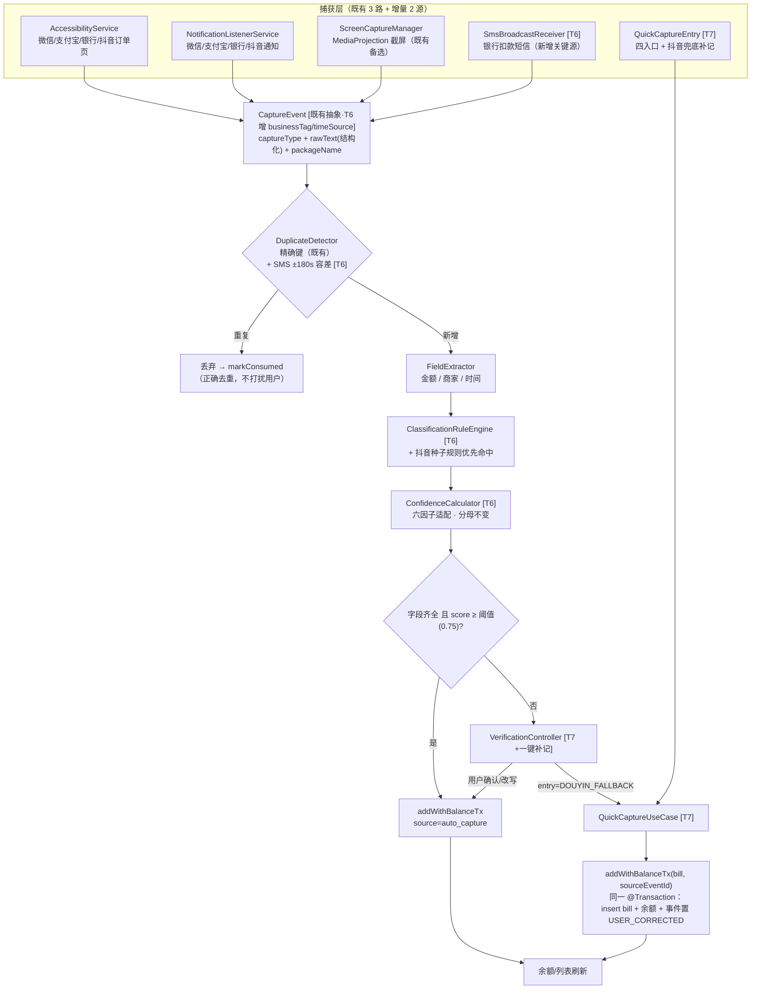
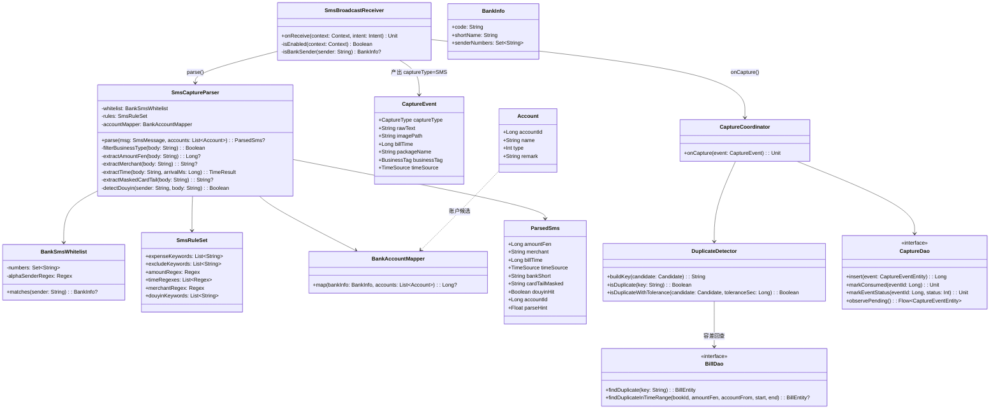
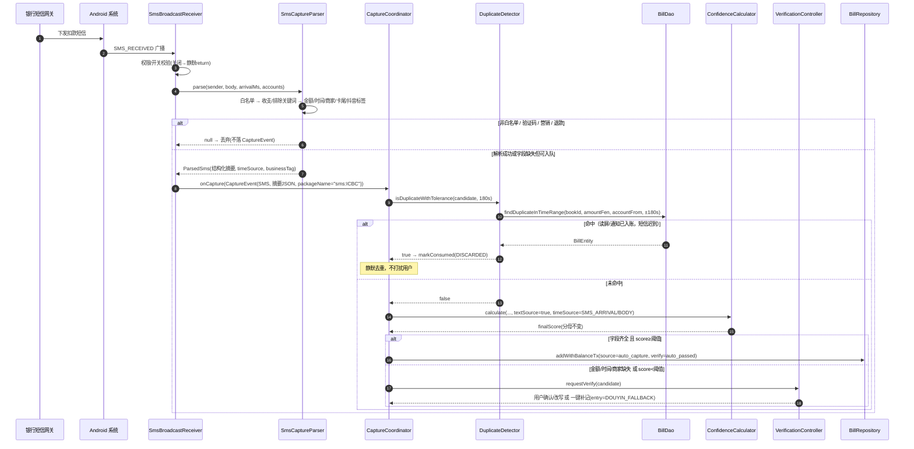
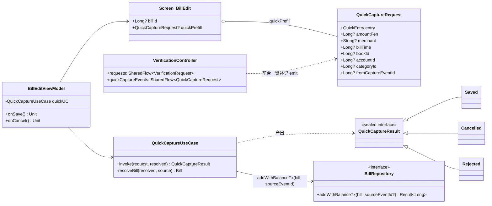
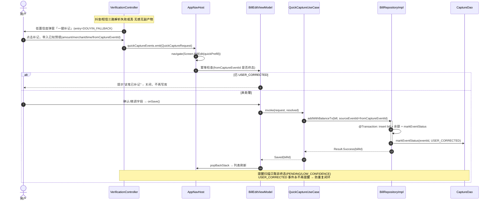
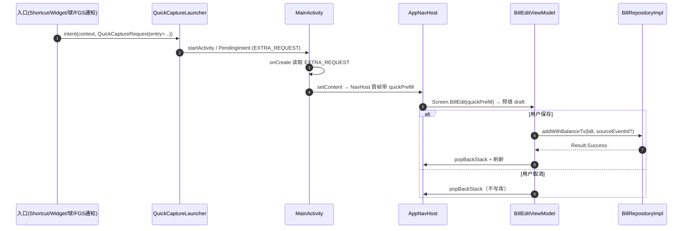
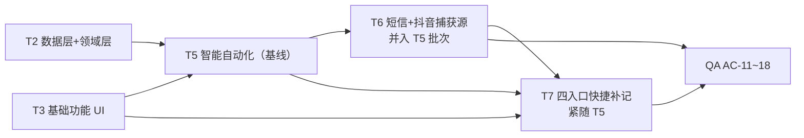

# 增量架构设计：抖音识别与快捷输入（第 23 章配套）

| 项目 | 内容 |
| --- | --- |
| 文档版本 | V1.0（增量架构，基于主架构 V1.0） |
| 上游输入 | `01b_增量PRD_抖音识别与快捷输入.md`（V1.2，第 23 章，289 行）；`02_系统架构设计.md`（T1~T5、`CaptureEvent`、`DuplicateDetector`、六因子模型、§9 约定） |
| 增量范围 | 仅描述**新增与修改**部分；与主架构的融合点单列，不重复主架构章节 |
| 交付目标 | 银行扣款短信捕获源 + 抖音三路业务打标 + 四入口快捷补记，全部汇入既有 `CaptureEvent` 管线 |
| 核心原则 | **不另起管线、零 schema 变更（枚举扩展 + 规则数据 + DAO 方法重载，均不建新表不加列）** |
| 阅读对象 | 工程师（T5 批次合并实现）、QA（AC-11~AC-18 架构落点）、主理人（Q-DY-1~4 决策审阅） |
| 关联交付物 | 本文内嵌 Mermaid 图；主架构的 `class-diagram.mermaid` / `sequence-diagram.mermaid` **不覆盖**（增量类图/时序图内嵌于本文 §2.1、§2.6、§4.1、§4.6） |

---

## 0. 结论先行（设计决策摘要）

| # | 决策项 | 结论 | 证据 / 理由 |
| --- | --- | --- | --- |
| D-INC-1 | 最终字段方案 | **加 2 处枚举值、0 新增列、0 新表、2 个 DAO 方法重载、1 个 Repository 重载**；`source += QUICK_MANUAL`，`captureType += SMS`，抖音用 `packageName` + 种子规则表达（**不加 `douyin` 枚举**）；`fromCaptureEventId` **契约层保留、DB 层不新增列** | 见 §1.4；关联在 `CaptureEvent` 侧以终态 `USER_CORRECTED` 闭环即可阻断重复提醒，无需 Bill→Event 反向列 |
| D-INC-2 | 短信去重容差 | 复用 `DuplicateDetector` 新增 `isDuplicateWithTolerance(c, 180s)`；**容差键弱化 remark**（仅 `bookId + amountFen + accountFrom + 时间窗`） | 跨源商家名天然不同（短信"商户名称:星巴克" vs 读屏"星巴克"），remark 参与容差匹配会导致大量漏去重，这是本次最关键的技术细化 |
| D-INC-3 | 置信度适配 | 六因子**权重分母完全不变**，`ConfidenceCalculator.calculate` 加 `textSource: Boolean` 重载；文本源 OCR 因子直接 1.0；仅短信到达时间时时间因子取 0.5 | PRD 23.1.5；主架构 §5.3 模型不破坏，QA 可直接复用 AC-2 阈值逻辑 |
| D-INC-4 | 快捷入口路由 | **统一收敛到 Navigation Compose 路由参数**（`Screen.BillEdit(quickPrefill: QuickCaptureRequest)`）；SharedFlow 仅作"前台弹窗→路由"的触发器，不作为跨入口主通道 | 冷启动（Shortcut/Widget/FGS/悬浮球在 App 未启动时）只能靠 Intent 携带参数，SharedFlow 无法跨进程/冷启动；最终表单只认一个入参 |
| D-INC-5 | 单一写事务 | 所有快捷补记收敛到 `BillRepositoryImpl.addWithBalanceTx(bill, sourceEventId?)` 重载：同一 `@Transaction` 内插入账单 + 更新余额 + 标记事件 `USER_CORRECTED`；取消不写库 | 主架构 N4/§9.5 铁律：UI 不写 DB，余额一致性单一写入口 |
| D-INC-6 | 任务落点 | **T6（短信 + 抖音捕获源）并入 T5 批次一起做**；**T7（四入口快捷补记）紧随 T5**、与 T3 表单预填小改一起做；T1/T2 地基不返工 | PRD 23.3.3；T6 的改动几乎全在 T5 已有类内部，拆开做必然二次返工 |

---

## 1. 增量设计总览

### 1.1 核心原则

1. **不另起管线**：短信源、抖音读屏/通知只是新的 `CaptureEvent` 生产者，产出后走完全相同的 `DuplicateDetector → FieldExtractor → ClassificationRuleEngine → ConfidenceCalculator → 校对/入账` 链路。快捷补记不进入自动管线，只在末尾复用同一写事务。
2. **零或极少 schema 变更**：能用枚举扩展、规则数据、内存模型字段解决的，绝不加 DB 列；必须加的只有 2 个 DAO 查询/更新方法（不改表结构、不改主键、不改事务边界）。
3. **抖音是"业务标签"不是"捕获类型"**：`captureType` 保持为"信号来源物理形态"语义，抖音由 `packageName=com.ss.android.ugc.aweme` + 种子关键词在规则层表达，避免枚举与业务耦合膨胀。
4. **隐私默认最小留存**：短信正文不落库、不落日志、不联网、不入备份；只落结构化字段与脱敏卡尾号。
5. **能力边界如实告知**：真·无感扣款做不到（证据链见 PRD 23.1.1），设置页固定文案写死，用快捷补记兜底而非虚假承诺。

### 1.2 新增 / 修改组件一览

| 层 | 组件 | 类型 | 批次 | 说明 |
| --- | --- | --- | --- | --- |
| automation/service | `SmsBroadcastReceiver` | **新增** | T6 | 接收 `RECEIVE_SMS` 广播，白名单过滤后交解析引擎 |
| automation/capture | `SmsCaptureParser` | **新增** | T6 | 银行号白名单 + 收支/验证码/营销过滤 + 金额/时间/商家/卡尾提取 |
| automation/capture | `BankSmsRule` / `BankSmsWhitelist` | **新增** | T6 | 银行号→简称→账户映射规则集（数据类 + 白名单 Set） |
| automation/capture | `ParsedSms` | **新增** | T6 | 短信解析结果（纯 Kotlin data class） |
| automation/classify | `DouyinBusinessTagger` | **新增** | T6 | 三路统一打标：`packageName` + 关键词 → `BusinessTag.DOUYIN` |
| automation/dedup | `DuplicateDetector` | **修改** | T6 | 新增 `isDuplicateWithTolerance(c, toleranceSec)`；原 `buildKey/isDuplicate` 不动 |
| automation/capture | `CaptureEvent` | **修改** | T6 | 内存模型新增 `businessTag: BusinessTag`、`timeSource: TimeSource`（**非 Entity**） |
| automation/ocr | `ConfidenceCalculator` | **修改** | T6 | `calculate` 新增 `textSource: Boolean` 重载，权重分母不变 |
| automation/classify | `ClassificationRuleEngine` | **修改** | T6 | `classify` 新增带 `packageName/businessTag` 的重载，抖音种子规则优先命中 |
| automation/service | `PaymentAccessibilityService` | **修改** | T6 | 抖音包名窗口事件打标 + 完成态关键词扩展（订单号） |
| automation/service | `PaymentNotificationListenerService` | **修改** | T6 | 抖音包名通知打标 + 银行代扣通知交解析器 |
| automation/service | `AutoCaptureForegroundService` | **修改** | T7 | 常驻通知新增「记一笔」PendingIntent action |
| automation/verify | `VerificationController` | **修改** | T7 | 弹窗新增「一键补记」按钮 → 发 `QuickCaptureRequest` 路由事件；终态事件跳过提醒 |
| domain/model | `BillSource` / `CaptureType` | **修改** | T6/T7 | `+QUICK_MANUAL` / `+SMS` |
| domain/model | `BusinessTag` / `TimeSource` / `CaptureEventStatus` | **新增** | T6 | 业务标签 / 时间来源 / 事件终态枚举（**纯领域模型，非 Entity**） |
| domain/model | `QuickEntry` / `QuickCaptureRequest` / `QuickCaptureResult` | **新增** | T7 | 快捷入口契约（内存/Intent 传递，**不落 DB**） |
| domain/usecase/quick | `QuickCaptureUseCase` | **新增** | T7 | 校验 + 调 `addWithBalanceTx` 重载 + 结果封装 |
| data/db/dao | `BillDao` | **修改** | T6 | 新增 `findDuplicateInTimeRange(...)`（容差查询） |
| data/db/dao | `CaptureDao` | **修改** | T6/T7 | 新增 `markEventStatus(id, status)`、`observePending()` |
| data/repository | `BillRepository` / `BillRepositoryImpl` | **修改** | T7 | `addWithBalanceTx` 新增 `sourceEventId: Long? = null` 重载 |
| data/local/db | `CategoryRuleEntity` | **数据变更** | T6 | 注入约 15 条抖音种子规则（**不改表结构/字段**） |
| ui/navigation | `Screen` / `AppNavHost` | **修改** | T7 | `Screen.BillEdit` 增 `quickPrefill` 参数并接入 |
| ui/bill | `BillEditScreen` / `BillEditViewModel` | **修改** | T7 | 支持外部预填、幂等短路、取消不写库 |
| ui/quick | `QuickCaptureLauncher` / `QuickBallService` | **新增** | T7 | 四入口 Intent 归一化 + 悬浮球 WindowManager 管理 |
| ui/widget | `QuickCaptureWidget` / `QuickCaptureWidgetReceiver` | **新增** | T7 | Glance 桌面组件（今日已记 / 预算余额 / 记一笔） |
| res/xml | `shortcuts.xml` | **新增** | T7 | 静态 App Shortcut 定义 |
| ui/settings | `AutomationSettingsScreen` / `AutomationSettingsViewModel` | **修改** | T6/T7 | 短信识别开关 + 权限卡片 + 悬浮球开关 + 能力边界文案 |
| core/di | `AutomationModule` | **修改** | T6/T7 | 补充新增类绑定 |
| AndroidManifest.xml | — | **修改** | T6/T7 | `READ_SMS`/`RECEIVE_SMS`、Receiver、WidgetReceiver、shortcuts 元数据 |

### 1.3 与既有管线的融合图



### 1.4 最终字段方案（拍板）

| 维度 | 现有取值 | **最终方案** | 是否动 T2 地基 | 理由 |
| --- | --- | --- | --- | --- |
| 账单 `source`（`BillEntity.source`） | `manual / import / auto_capture` | **`+ QUICK_MANUAL`** | 否（仅枚举常量扩展） | 快捷补记属手动性质，单列来源便于统计；**不加 `sms/douyin/shortcut` 到账单级**（那是捕获/入口维度，不是账单维度） |
| 事件 `captureType`（`CaptureEventEntity.captureType`） | `accessibility_text / projection_image / notification` | **`+ SMS`** | 否（仅枚举常量扩展） | 短信是真正的新捕获形态；抖音读屏/通知复用原类型 + `packageName`，**不加 `douyin` 枚举**，避免物理来源与业务来源混淆 |
| 抖音业务标签 | 无 | `CaptureEvent.businessTag: BusinessTag`（**内存字段**）+ `CategoryRuleEntity` 种子规则（**数据**） | 否 | 业务标签不落新列；持久化语义由 `categoryId` 命中体现，对账需要时在 `rawText` 结构化摘要里置 `"dy":true` |
| 快捷入口来源 | 无 | `QuickCaptureRequest.entry`（**内存 / Intent 契约**） | 否 | 入口维度仅用于路由、埋点、事件关联，**不写账单表** |
| 关联 `fromCaptureEventId` | 无 | **契约层保留，DB 层不加列** | 否 | 见下方专述 |
| 事件处理状态 | `status: Int`（`markConsumed`） | 枚举化 `CaptureEventStatus`：`PENDING(0)/LOW_CONFIDENCE(1)/CONSUMED_AUTO(2)/USER_CORRECTED(3)/DISCARDED(4)`，**复用现有 Int 列** | 否 | "防重复提醒"在事件侧以终态闭环；`markConsumed` 保持兼容（内部写 `CONSUMED_AUTO`） |

**关于 `fromCaptureEventId` 的决策（Q-DY-3 的技术落点）：**

- **契约层必须有**：`QuickCaptureRequest.fromCaptureEventId: Long?` 是 `DouyinFallback` 补记的必要入参——它告诉系统"这次补记是在处理哪个失败事件"。
- **DB 层不新增列**：补记成功时，在同一个 `@Transaction` 内把该事件置为 `USER_CORRECTED(3)` 终态；提醒/校对扫描只看非终态事件（`PENDING/LOW_CONFIDENCE`），终态事件一律跳过。**从 Bill 反查 Event 的需求并不存在**，因此不需要 Bill 表存 eventId。
- **一致性保障**：不采用"先调 `CommitManualBillUseCase` 再调 `markEventStatus` 两步走"（存在 bill 成功但 event 未标记→重复提醒一次的小概率不一致），而是给 `addWithBalanceTx` 加可选 `sourceEventId` 参数，一个事务内完成三件事。
- **未来扩展口**：若主理人后续要求"账单详情显示来源事件 / 对账追溯"，P2 可加独立关联表 `BillCaptureLink(billId, eventId)`，**仍不动 `BillEntity` 主表**。

---

## 2. 银行扣款短信捕获源详细设计（T6 关键）

### 2.1 类设计



> 注：`Account` 即主架构领域模型 `com.azu.bookkeeper.domain.model.Account`（此处列出关键字段以表达 `BankAccountMapper` 的依赖）。

### 2.2 SmsBroadcastReceiver：接收与开关

| 项 | 设计 |
| --- | --- |
| 注册方式 | Manifest 静态注册 `<receiver android:name=".automation.service.SmsBroadcastReceiver" android:permission="android.permission.RECEIVE_SMS" exported="false">`，`intent-filter` 仅 `android.provider.Telephony.SMS_RECEIVED`，**不设高 priority**（不干扰系统/默认短信 App） |
| 动态开关 | 设置页「短信识别」开关关闭时，用 `PackageManager.setComponentEnabledSetting(component, COMPONENT_ENABLED_STATE_DISABLED, ...)` 禁用 Receiver；开启时恢复 `..._DEFAULT`。这是静态 Receiver 唯一可靠的"一键停用"方式 |
| 权限撤销 | 代码**不能自行撤销** `READ_SMS`；开关卡片提供 `ACTION_APPLICATION_DETAILS_SETTINGS` 跳转，文案说明"如需彻底撤销权限请在此关闭短信权限" |
| 运行时校验 | `onReceive` 首行检查 `ContextCompat.checkSelfPermission(READ_SMS) == GRANTED` 且开关 enabled，否则静默 return（非异常，不崩溃） |
| 取数 | `Telephony.Sms.Intents.getMessagesFromIntent(intent)` → 逐条 `message.getDisplayOriginatingAddress()` / `getDisplayMessageBody()` / `getTimestampMillis()`；**正文仅存在于本方法栈帧内** |
| 转交 | 构造 `CaptureEvent(captureType=SMS, rawText=结构化摘要JSON, billTime=解析时间, packageName="sms:" + bankCode, businessTag, timeSource)`，交 `CaptureCoordinator.onCapture()`；**不写日志正文** |
| 广播是异步的 | `onReceive` 在主线程且只有 ~10s，解析为纯正则运算（<5ms），同步完成即可；**不起 coroutine / 不 goAsync**（避免把正文带入异步作用域增加留存面） |

### 2.3 解析引擎规则（`SmsCaptureParser.parse`）

| 环节 | 规则 | 失败处理 |
| --- | --- | --- |
| 发件人过滤 | `BankSmsWhitelist.matches()`：数字短号白名单（95588/95533/95566/95559/95511/95561/95558/95595 等）+ alpha sender 正则 `(?i).*(银行\|bank\|credit).*`；命中返回 `BankInfo(code, shortName)` | 非白名单直接 `return null`，**不落入 CaptureEvent** |
| 业务类型 | 命中 `支出\|扣款\|消费\|交易\|支付\|转出` 之一，且**不命中** `验证码\|营销\|退款\|返还\|收入\|存入\|还款入账\|积分\|活动` | 排除类 `return null`；过滤阶段不提示用户（PRD 23.3.1 明确"过滤时不提示"） |
| 金额提取 | `¥?\s*([\d,]+\.\d{2})` 或 `人民币\s*(\d+(?:\.\d{1,2})?)元`；去千分位 → `Money.toFen(BigDecimal)` | 无金额 → 仍产出 `CaptureEvent` 但 `amountFen=null` + `parseHint` 降低 → 强制校对 |
| 时间提取 | 优先 `yyyy-MM-dd HH:mm` / `MM月dd日 HH:mm` / `yyyy年MM月dd日`；无则 `arrivalMs`，置 `timeSource=SMS_ARRIVAL` | 正文时间命中 `TimeSource.BODY`；到达时间 `TimeSource.SMS_ARRIVAL`（置信度因子 0.5） |
| 商家提取 | `(?:商户\|交易对手\|收款方\|商户名称)\s*[:：]\s*([^\s,，。]+)`；无则 `"银行扣款-" + bankShort` | 商家非空但为兜底串 → `parseHint` 降低；完全为空 → 强制校对 |
| 账户映射 | `BankAccountMapper.map(bankInfo, accounts)`：按 `AccountEntity.remark` 含银行简称 / 卡尾匹配储蓄卡或信用卡；未命中 → 默认账户 + 账户因子 0 | 走主架构 §5.3「账户未命中」处理，不静默 |
| 卡尾脱敏 | `(\d{4})\d{8,11}(\d{4})` → `$1****$2`，仅写结构化摘要 | 原文绝不入库 |
| 抖音打标 | `douyinKeywords = [抖音, 抖音支付, 抖音商城, 巨量引擎, douyin, aweme]` 命中 → `businessTag=DOUYIN` | 未命中不影响入账 |

**关键：短信原文不落库。** 写入 `CaptureEventEntity.rawText` 的是**结构化摘要**（Kotlinx Serialization JSON）：

```json
{"src":"sms","bank":"ICBC","amountFen":1500,"merchant":"星巴克","billTime":1732241400000,
 "timeSrc":"BODY","cardTail":"6222****1234","dy":false,"acct":3}
```

这样 `rawText` 字段既保留了主架构 `FieldExtractor` 的输入形态，又满足"最小留存"（PRD 23.1.3）。`FieldExtractor` 对短信源走 `textSource=true` 分支，直接读摘要字段，不重复跑正则。

### 2.4 与 DuplicateDetector 的容差去重接入

**关键算法签名（伪代码）：**

```kotlin
// DuplicateDetector（修改：新增方法，原两方法不动）
fun isDuplicateWithTolerance(c: Candidate, toleranceSec: Long = 0): Boolean {
    // 1) 精确键优先（所有源共用，零成本命中）
    if (isDuplicate(buildKey(c))) return true
    // 2) 仅短信源启用容差；toleranceSec<=0 等价于原行为
    if (c.captureType != CaptureType.SMS || toleranceSec <= 0) return false
    // 3) 容差键：刻意不含 remark（跨源商家名不同是常态）
    return billDao.findDuplicateInTimeRange(
        bookId      = c.bookId,
        amountFen   = c.amountFen,
        accountFrom = c.accountId,
        start       = c.billTime - toleranceSec * 1000L,
        end         = c.billTime + toleranceSec * 1000L
    ) != null
}

// BillDao（修改：新增查询，不改表）
@Query("""SELECT * FROM bill_entity
          WHERE book_id=:bookId AND amount_fen=:amountFen AND account_from=:accountFrom
            AND bill_time BETWEEN :start AND :end
          ORDER BY bill_time DESC LIMIT 1""")
fun findDuplicateInTimeRange(bookId: Long, amountFen: Long,
                             accountFrom: Long, start: Long, end: Long): BillEntity?
```

**为什么容差键弱化 `remark`（关键技术决策）：**

| 场景 | 精确键（含 remark） | 容差键（不含 remark） |
| --- | --- | --- |
| 读屏抓到"星巴克 ¥15"，短信写"商户名称:星巴克 ¥15" | 备注哈希不同 → 漏去重 → **重复账单** | 金额 15 + 同账户 + 180s 窗 → 命中 → 正确丢弃 |
| 同一账户 3 分钟内两笔相同 15 元（如两次地铁） | 正常记两笔 | **可能误合并为一笔**（容差固有风险） |

- 误合并风险由三点缓解：① 容差默认 180s 且 DataStore 可配 0~600s；② 容差**仅在短信源**启用，读屏/通知仍走精确键；③ 设置页文案提示"短时间同额消费被误合并可将容差调小"。
- 对个人自用记账，"重复账单"比"偶发合并"更伤害对账体验，因此选择弱化 remark。
- 时间取值优先级（PRD 23.1.4）：`TimeSource.BODY > SMS_ARRIVAL`；用到达时间时 `parseHint` 降低且 `timeSource` 写入事件，供置信度因子使用。
- 幂等：`CaptureCoordinator.onCapture` 仍按 `eventId` 幂等；`DuplicateDetector` 判重后 `markConsumed`；终态事件不再进入校对队列。

**±180s 是否合适的评估（Q-DY-2）**：银行扣款短信到达延迟 P99 通常在 3 分钟内，180s 是对"延迟覆盖"与"同额误合并"的合理平衡点；采用**对称窗口**以覆盖"短信先到、读屏后到"的少见情形。给 DataStore 配置键 `smsDedupToleranceSec`（0~600，默认 180）。结论：**采纳 180s 默认值**。

### 2.5 隐私实现

| 要求 | 落点 |
| --- | --- |
| 正文不联网 | 模块无任何网络依赖；`SmsCaptureParser` 只做本地正则； Gradle 无新增网络库（T1 不受影响） |
| 正文不落日志 | `Timber` 只打印 `eventId / amountFen / bankShort / timeSource`；`proguard-rules.pro` 增加规则移除 `SmsCaptureParser` 的 verbose 日志（release variant） |
| 正文不入备份 | `CaptureEventEntity.rawText` 存结构化摘要而非原文；`res/xml/backup_rules.xml` 显式 `<exclude domain="database" path="bookkeeper.db"/>`（主架构本就加密，此处再确认短信源无额外文件） |
| 最小留存 | 仅结构化字段 + 脱敏卡尾号落 `EncryptedFile`/SQLCipher 加密库；卡尾 `6222****1234` |
| 一键关权限 | 设置页开关 → `setComponentEnabledSetting(DISABLED)` + 跳转系统权限页；关闭后 `SmsBroadcastReceiver.onReceive` 首行返回，其余三源继续工作，不崩溃（AC-17） |
| 权限用途说明 | 申请 `READ_SMS` 前先弹应用内卡片："仅用于识别银行扣款短信，本地解析，不上传、不存储原文，可随时关闭"；符合 D-02 不静默获取 |
| 不设默认短信 App | PRD 23.1.3 明确；本应用只做被动接收，不写 `SMS_DELIVER`、不调用 ` Telephony.Sms.getDefaultSmsPackage` |

### 2.6 数据流时序图（银行短信 → 去重 → 入账/校对）



---

## 3. 抖音识别接入（T6）

### 3.1 三路业务打标机制

统一打标入口 `DouyinBusinessTagger.tag(source: CaptureSource): BusinessTag`，三路共用：

| 路 | 判定输入 | 强信号 | 打标时机 | 落地 |
| --- | --- | --- | --- | --- |
| 读屏 | `AccessibilityEvent.packageName == "com.ss.android.ugc.aweme"` + 窗口文字含 `支付成功\|已支付\|订单号\|¥` | `packageName` 命中即强信号（即使金额节点在子 View） | `PaymentAccessibilityService` 组 `CaptureEvent` 时 | `businessTag=DOUYIN`，`packageName` 原样保留 |
| 通知 | `StatusBarNotification.packageName == "com.ss.android.ugc.aweme"` + 标题/正文含 `支付成功\|扣款\|支出` | 包名命中 | `PaymentNotificationListenerService` 过滤后 | 同上；通知正文交 `FieldExtractor(textSource=true)` |
| 短信 | 正文含 `抖音\|抖音支付\|抖音商城\|巨量引擎\|douyin\|aweme` | 关键词命中（短信无抖音进程包名，用 `packageName="sms:<bankCode>"` + 关键词） | `SmsCaptureParser.detectDouyin()` | `businessTag=DOUYIN` + 摘要 `"dy":true` |

- `BusinessTag` 枚举：`NONE / DOUYIN`。预留扩展位（未来快手/拼多多），但 V1 只实现抖音。
- 打标**不改变** `captureType`（仍是 `ACCESSIBILITY_TEXT / NOTIFICATION / SMS`），符合 D-INC-1。
- 三路命中同一笔时，由 `DuplicateDetector` 统一去重（含短信容差），只保留一条账单。

### 3.2 抖音种子规则注入 `CategoryRuleEntity`（不新增表）

**规则数据（约 15 条，优先级高于通用规则）：**

| keyword | categoryId | priority | 用途 |
| --- | --- | --- | --- |
| 抖音支付 | 用户配置（默认"购物"） | 100 | 业务识别 + 分类 |
| 抖音 | 同上 | 100 | 业务识别 |
| 抖音商城 | 同上 | 100 | 业务识别 |
| 巨量引擎 | 同上 | 100 | 业务识别 |
| douyin / aweme | 同上 | 100 | 业务识别（英文） |
| 支付成功 / 已支付 / 付款成功 / 交易成功 / 订单号 | 不直接分类（仅提升"支付已发生"判定） | 90 | 完成态确认 |
| ¥ / 元 / 收款方 / 商户名称 / 订单金额 | 不直接分类 | 80 | 辅助 `FieldExtractor` 抽取 |

**注入策略（工程师落地细则）：**

1. `CategoryRuleEntity` 现有字段 `(ruleId, keyword, categoryId, priority, enabled)` 完全够用，**不改表结构**。
2. 新增 `SeedRules` 数据对象（放 `automation/classify/`，纯 Kotlin），App 首次启动由 `AutomationModule` 提供的 `SeedRuleInitializer` 写入 `CategoryRuleDao`，**幂等**（按 keyword 查重，已存在则跳过，不覆盖用户改动）。
3. 通用种子规则（主架构 Q2 的 30~50 条商家词）`priority` 设为 10~50；抖音种子规则 80~100，保证 `RuleDao.match()` 按 `priority DESC` 返回时抖音规则优先。
4. 用户可在分类管理页增删改这些规则（`CategoryRuleEntity` 本就可增删改），改 `priority` 或 `categoryId` 即改变抖音默认分类，**无需改代码**（覆盖 Q-DY-1 的"用户可自定义"要求）。
5. 抖音包名 `com.ss.android.ugc.aweme` 作为**额外强信号**在 `ClassificationRuleEngine.classify` 重载中直接参与判定，即使关键词未命中也可打标（但不强行分类——若无关键词仍归"其他支出"并扣分触发弹窗）。

### 3.3 置信度六因子适配（分母不变）

`ConfidenceCalculator.calculate` 新增重载（**原方法保留，权重表不动**）：

```kotlin
fun calculate(
    result: OcrResult?,          // 文本源传 null；图像源传 ML Kit 结果
    fields: ExtractedFields,
    ruleHit: RuleHit,
    textSource: Boolean = false, // [T6] 文本源=true
    timeSource: TimeSource = TimeSource.BODY, // [T6]
    businessTag: BusinessTag = BusinessTag.NONE // [T6]
): Float
```

| 因子 | 权重（不变） | 文本源（读屏/通知/短信） | 图像源（截屏 OCR） | 抖音增强 |
| --- | --- | --- | --- | --- |
| OCR 引擎置信度 | 0.30 | **直接 1.0**（系统直出文字，无 OCR 误差） | ML Kit `block.confidence` 均值 | 同左 |
| 金额合法 | 0.25 | 正则命中且 >0 → 1，否则 0 | 同左 | 同左 |
| 时间可解析 | 0.15 | `BODY`→1；仅 `SMS_ARRIVAL`→**0.5**（酌减，PRD 23.1.5） | 命中→1 | 同左 |
| 商家非空 | 0.10 | 非空→1；空→0 且强制校对 | 同左 | 同左 |
| 分类规则命中 | 0.15 | 命中关键词→1；未命中→0 且归"其他支出" | 同左 | **抖音种子命中→1**；包名命中但无关键词→0（归其他支出+弹窗） |
| 账户匹配 | 0.05 | 银行号/默认账户映射→1 | 同左 | 抖音包名映射→1 |

- `needVerify` 判定沿用主架构 §5.3：金额/时间/商家任一缺失 → 强制弹窗；`finalScore < threshold(0.75)` → 弹窗。
- **验证算式**（QA 可复核）：典型抖音短信（有正文时间 + 抖音词命中 + 商家非空 + 账户命中）得分 = `0.30×1 + 0.25×1 + 0.15×1 + 0.10×1 + 0.15×1 + 0.05×1 = 1.00`，自动入账；仅到达时间时 = `1.00 − 0.15×0.5 = 0.925`，仍达标但已在事件上标记 `SMS_ARRIVAL` 供追溯；字段缺失（如无商家）强制弹窗，不依赖分数。
- 阈值行为与 AC-2 完全一致（AC-18）。

---

## 4. 快捷输入接口 `QuickCaptureEntry` 契约落地（T7）

### 4.1 Kotlin 契约定义

```kotlin
// domain/model/QuickEntry.kt
enum class QuickEntry {
    APP_SHORTCUT, APP_WIDGET, FLOATING_BALL, FG_NOTIFICATION, DOUYIN_FALLBACK
}

// domain/model/QuickCaptureRequest.kt —— Parcelable（Intent 跨入口传递）
@Parcelize
data class QuickCaptureRequest(
    val entry: QuickEntry,
    val amountFen: Long? = null,
    val merchant: String? = null,
    val billTime: Long? = null,          // 默认 System.currentTimeMillis()
    val bookId: Long? = null,
    val accountId: Long? = null,
    val categoryId: Long? = null,
    val fromCaptureEventId: Long? = null // 契约保留；DB 不加列（见 §1.4）
) : Parcelable

// domain/model/QuickCaptureResult.kt
sealed interface QuickCaptureResult {
    data class Saved(val billId: Long) : QuickCaptureResult
    data object Cancelled : QuickCaptureResult
    data class Rejected(val error: AppError) : QuickCaptureResult
}

// domain/usecase/quick/QuickCaptureUseCase.kt
class QuickCaptureUseCase @Inject constructor(
    private val billRepository: BillRepository,
    private val settings: SettingsRepository
) {
    suspend operator fun invoke(
        request: QuickCaptureRequest,
        resolved: ResolvedBillInput // 表单最终值：amountFen/merchant/time/book/account/category
    ): QuickCaptureResult {
        if (resolved.amountFen == null || resolved.amountFen <= 0)
            return QuickCaptureResult.Rejected(AppError.E_BILL_001) // 金额校验，同 §7 表单
        val bill = resolveBill(resolved, source = BillSource.QUICK_MANUAL)
        return when (val r = billRepository.addWithBalanceTx(
            bill = bill,
            sourceEventId = request.fromCaptureEventId // 同事务标记事件 USER_CORRECTED
        )) {
            is Result.Success -> QuickCaptureResult.Saved(r.data)
            is Result.Error   -> QuickCaptureResult.Rejected(r.error)
        }
    }
}

// ui/quick/QuickCaptureLauncher.kt —— 四入口归一化
object QuickCaptureLauncher {
    const val EXTRA_REQUEST = "quick_capture_request"
    fun intent(context: Context, request: QuickCaptureRequest): Intent =
        Intent(context, MainActivity::class.java).apply {
            flags = Intent.FLAG_ACTIVITY_NEW_TASK or Intent.FLAG_ACTIVITY_CLEAR_TOP
            putExtra(EXTRA_REQUEST, request)
        }
    fun pendingIntent(context: Context, request: QuickCaptureRequest, reqCode: Int): PendingIntent =
        PendingIntent.getActivity(context, reqCode, intent(context, request),
            PendingIntent.FLAG_UPDATE_CURRENT or PendingIntent.FLAG_IMMUTABLE)
}
```

**类关系图（契约层）：**



### 4.2 四入口统一调用

| 入口 | 触发载体 | 如何进入统一契约 | 是否新增权限 |
| --- | --- | --- | --- |
| App Shortcut | `res/xml/shortcuts.xml` 静态定义，`<intent>` 指向 `MainActivity` 并带 `entry=APP_SHORTCUT` | `QuickCaptureLauncher.intent()` | 否 |
| AppWidget | Glance `QuickCaptureWidget` 的 `onClick` → `actionStartActivity(QuickCaptureLauncher.intent(...))`；数据用 `GlanceStateDefinition` 从 T2 Repository 聚合"今日已记/预算余额" | 同上 | 否 |
| 悬浮球 | `QuickBallService`（`WindowManager.addView` 自定义 View，复用 `SYSTEM_ALERT_WINDOW`）点击 → `startActivity(QuickCaptureLauncher.intent(entry=FLOATING_BALL))` | 同上 | 否（复用主架构悬浮窗权限） |
| FGS 通知 | `AutoCaptureForegroundService` 常驻通知增加 Action，PendingIntent = `QuickCaptureLauncher.pendingIntent(entry=FG_NOTIFICATION)` | 同上 | 否（复用 FGS + POST_NOTIFICATIONS） |
| DouyinFallback | 低置信度弹窗「一键补记」按钮 → `VerificationController.quickCaptureEvents.emit(request)`（前台）→ `AppNavHost` 收集后 navigate | **SharedFlow 分支**（前台同进程） | 否 |

四入口在 `MainActivity.onCreate` 统一读取 `EXTRA_REQUEST`，转成路由参数；前台 `DouyinFallback` 走 SharedFlow 分支，**两条路径最终都落到 `Screen.BillEdit(quickPrefill)`**。

### 4.3 路由传参 vs SharedFlow 方案选型（拍板）

| 方案 | 冷启动 | 跨进程/系统组件 | 前台弹窗 | 结论 |
| --- | --- | --- | --- | --- |
| 纯 SharedFlow | ❌ 进程未起，无人 collect，事件丢失 | ❌ Intent 无法携带 Flow | ✅ | 不可行 |
| **路由参数为主 + SharedFlow 为辅** | ✅ Intent → MainActivity → NavHost 路由 | ✅ 四入口都是 Intent/PendingIntent | ✅ 前台 emit 后 NavHost 收集并 navigate | **采纳** |

落地：

```kotlin
sealed class Screen : Parcelable {
    @Parcelize data class BillEdit(
        val billId: Long? = null,
        val quickPrefill: QuickCaptureRequest? = null
    ) : Screen()
}

// AppNavHost 内
LaunchedEffect(Unit) {
    verificationController.quickCaptureEvents.collect { req ->
        navController.navigate(Screen.BillEdit(quickPrefill = req))
    }
}
val prefill = intent.extras?.getParcelable<QuickCaptureRequest>(EXTRA_REQUEST)
// 冷启动首次组合时把 prefill 交给 BillEdit 路由
```

- `BillEditScreen` 只认 `quickPrefill` 一个入参，不关心来自哪个入口；入口差异体现在 `entry` 字段（埋点/统计可选）。
- 预填规则：调用方传了就用，未传则留空或取 `SettingsRepository` 默认值（默认账本、默认账户、当前时间）。

### 4.4 单一写事务与取消语义（AC-14）

- **保存**：`BillEditViewModel.onSave()` → `QuickCaptureUseCase` → `BillRepositoryImpl.addWithBalanceTx(bill, sourceEventId)`。该方法 `@Transaction` 内三件事：
  1. `billDao.insert(bill)`（`source=QUICK_MANUAL`、`verifyStatus=USER_CONFIRMED`；若用户改写了预填的抖音识别字段则 `USER_CORRECTED`）
  2. `accountDao.updateBalance(accountId, deltaFen)`
  3. `if (sourceEventId != null) captureDao.markEventStatus(sourceEventId, CaptureEventStatus.USER_CORRECTED.code)`
  任一步失败整体回滚，返回 `Result<Long>`。**与手动记账共用同一事务模板，不新增写库路径**。
- **取消**：`onCancel()` 只 `navController.popBackStack()`，不调任何 Repository/UseCase，不产生残留记录；`BillEditViewModel` 的 draft 状态随 ViewModel 清除。
- **校验**：金额必填且 >0（`E_BILL_001`）在表单内拦截，与主架构 §7 一致。
- **幂等**：进入 `BillEdit` 时若 `quickPrefill.fromCaptureEventId != null`，先查 `captureDao.observePending()`/单查该事件状态；若已为 `USER_CORRECTED/CONSUMED_AUTO`，直接提示"该笔已补记"并关闭表单，防止重复点击建单。保存时 `DuplicateDetector` 仍兜底。

### 4.5 DouyinFallback 预填补记与 `user_corrected` 防重复提醒



### 4.6 快捷入口类图补充与时序图

四入口的调用时序（以冷启动为例）：



---

## 5. 修改的文件清单（相对主架构 §3，精确到类名 + 批次）

### 5.1 新增文件

| 相对路径 | 关键类 / 声明 | 批次 |
| --- | --- | --- |
| `app/src/main/java/com/azu/bookkeeper/automation/service/SmsBroadcastReceiver.kt` | `SmsBroadcastReceiver` | T6 |
| `app/src/main/java/com/azu/bookkeeper/automation/capture/SmsCaptureParser.kt` | `SmsCaptureParser` | T6 |
| `app/src/main/java/com/azu/bookkeeper/automation/capture/BankSmsRule.kt` | `BankSmsWhitelist`, `BankInfo`, `SmsRuleSet`, `BankAccountMapper`, `ParsedSms` | T6 |
| `app/src/main/java/com/azu/bookkeeper/automation/classify/DouyinBusinessTagger.kt` | `DouyinBusinessTagger`, `SeedRules`, `SeedRuleInitializer` | T6 |
| `app/src/main/java/com/azu/bookkeeper/domain/model/BusinessTag.kt` | `BusinessTag`, `TimeSource`, `CaptureEventStatus` | T6 |
| `app/src/main/java/com/azu/bookkeeper/domain/model/QuickEntry.kt` | `QuickEntry`, `QuickCaptureRequest`, `QuickCaptureResult` | T7 |
| `app/src/main/java/com/azu/bookkeeper/domain/usecase/quick/QuickCaptureUseCase.kt` | `QuickCaptureUseCase` | T7 |
| `app/src/main/java/com/azu/bookkeeper/ui/quick/QuickCaptureLauncher.kt` | `QuickCaptureLauncher` | T7 |
| `app/src/main/java/com/azu/bookkeeper/ui/quick/QuickBallService.kt` | `QuickBallService`（悬浮球 WindowManager 管理） | T7 |
| `app/src/main/java/com/azu/bookkeeper/ui/widget/QuickCaptureWidget.kt` | `QuickCaptureWidget`（Glance） | T7 |
| `app/src/main/java/com/azu/bookkeeper/ui/widget/QuickCaptureWidgetReceiver.kt` | `QuickCaptureWidgetReceiver` | T7 |
| `app/src/main/res/xml/shortcuts.xml` | 静态 Shortcut `记一笔` | T7 |

### 5.2 修改文件

| 相对路径 | 修改点（类名 / 方法） | 批次 |
| --- | --- | --- |
| `domain/model/BillSource.kt` | `+QUICK_MANUAL` | T7 |
| `domain/model/CaptureType.kt` | `+SMS` | T6 |
| `automation/capture/CaptureEvent.kt` | `+businessTag`, `+timeSource`（内存字段） | T6 |
| `automation/ocr/ConfidenceCalculator.kt` | `calculate` 新增 `textSource/timeSource/businessTag` 重载 | T6 |
| `automation/classify/ClassificationRuleEngine.kt` | `classify` 新增带 `packageName/businessTag` 重载；种子规则优先 | T6 |
| `automation/dedup/DuplicateDetector.kt` | `+isDuplicateWithTolerance(c, toleranceSec)` | T6 |
| `automation/service/PaymentAccessibilityService.kt` | 抖音包名打标 + 订单号完成态关键词 | T6 |
| `automation/service/PaymentNotificationListenerService.kt` | 抖音包名打标 + 银行代扣通知解析 | T6 |
| `automation/service/AutoCaptureForegroundService.kt` | 常驻通知 +「记一笔」Action PendingIntent | T7 |
| `automation/verify/VerificationController.kt` | `+quickCaptureEvents: SharedFlow`；终态事件跳过提醒；弹窗「一键补记」按钮 | T7 |
| `data/local/db/dao/BillDao.kt` | `+findDuplicateInTimeRange(...)` | T6 |
| `data/local/db/dao/CaptureDao.kt` | `+markEventStatus(id, status)`, `+observePending()` | T6/T7 |
| `data/repository/BillRepository.kt` / `BillRepositoryImpl.kt` | `addWithBalanceTx(bill, sourceEventId: Long? = null)` 重载 | T7 |
| `data/local/db/CategoryRuleEntity.kt` | **无字段改动**；由 `SeedRuleInitializer` 灌入约 15 条种子数据 | T6 |
| `data/local/datastore/AutomationSettingsDataStore.kt` | `+smsEnabled`, `+smsDedupToleranceSec(180)`, `+floatingBallEnabled(false)`, `+douyinDefaultCategoryId` | T6/T7 |
| `ui/navigation/Screen.kt` / `AppNavHost.kt` | `Screen.BillEdit.quickPrefill` 参数 + SharedFlow 收集 navigate | T7 |
| `ui/bill/BillEditScreen.kt` / `BillEditViewModel.kt` | 外部预填、幂等短路、取消不写库、`source=QUICK_MANUAL` | T7 |
| `ui/settings/AutomationSettingsScreen.kt` / `AutomationSettingsViewModel.kt` | 短信识别开关/权限卡片、悬浮球开关、能力边界文案 | T6/T7 |
| `core/di/AutomationModule.kt` | 新增类 @Binds/@Provides；`SeedRuleInitializer` 绑定 | T6/T7 |
| `core/AppError.kt` | `+E_SMS_001`（权限被拒）, `+E_SMS_002`（解析失败）, `+E_BILL_001`（快捷金额非法） | T6/T7 |
| `app/src/main/AndroidManifest.xml` | `READ_SMS`, `RECEIVE_SMS`, `SmsBroadcastReceiver`, `QuickBallService`, `QuickCaptureWidgetReceiver`, `<meta-data android:name="android.app.shortcuts">` | T6/T7 |
| `app/proguard-rules.pro` | release 移除短信解析 verbose 日志规则 | T6 |
| `gradle/libs.versions.toml` | `+androidx.glance:glance-appwidget:1.1.0`、`+androidx.glance:glance-material3:1.1.0`（官方 AndroidX 组件，追加声明，**不改 T1 既有代码**） | T7 |

> **依赖影响澄清**：PRD 23.3.3 说"无新增第三方依赖，短信走 Framework API"——短信/悬浮球/Shortcut 确实零新增依赖；只有 AppWidget 采用 Glance（AndroidX 官方库，非第三方），需在 Version Catalog 追加 2 个坐标。这不改变 T1 已落地代码，T1 无需返工。若工程师坚持零依赖，AppWidget 可退化为传统 `RemoteViews`（功能不变、代码风格与 Compose 不一致），由主理人定夺。

---

## 6. 增量任务列表与 T5 融合

> 按团队任务上限，增量为 **2 个任务**，每个为高内聚模块组（远超 3 文件下限）。编号接续主架构 T1~T5。

### 6.1 T6 — 短信 + 抖音捕获源（P0，并入 T5 批次）

- **依赖**：T2（DAO / Repository / 领域模型）、T3（分类管理页种子规则可编辑）、T5（`CaptureCoordinator` / `DuplicateDetector` / `ConfidenceCalculator` / `ClassificationRuleEngine` / `VerificationController`）
- **涉及文件**：`SmsBroadcastReceiver.kt`, `SmsCaptureParser.kt`, `BankSmsRule.kt`, `DouyinBusinessTagger.kt`, `BusinessTag.kt`, `CaptureEvent.kt`, `ConfidenceCalculator.kt`, `ClassificationRuleEngine.kt`, `DuplicateDetector.kt`, `PaymentAccessibilityService.kt`, `PaymentNotificationListenerService.kt`, `BillDao.kt`, `CaptureDao.kt`, `AutomationSettingsDataStore.kt`, `AppError.kt`, `AutomationModule.kt`, `AndroidManifest.xml`, `proguard-rules.pro`
- **产出**：第四捕获源（银行短信）+ 抖音三路业务打标 + 种子规则注入 + 六因子适配 + ±180s 容差去重 + 短信隐私与降级 + 设置页开关/权限卡片/能力文案
- **验收**：AC-11 / AC-12 / AC-13 / AC-16（去重部分）/ AC-17 / AC-18；断网可用；短信正文不出现在任何日志与 DB 原文中；关闭开关后其余源正常工作

### 6.2 T7 — 四入口快捷补记（P0，紧随 T5，与 T3 表单预填小改一起做）

- **依赖**：T2（`addWithBalanceTx` 重载 / Repository）、T3（`BillEditScreen` / `BillEditViewModel` / `AppNavHost`）、T5（`AutoCaptureForegroundService` / `VerificationController`）、T6（`fromCaptureEventId` 事件终态语义）
- **涉及文件**：`QuickEntry.kt`, `QuickCaptureUseCase.kt`, `QuickCaptureLauncher.kt`, `QuickBallService.kt`, `QuickCaptureWidget.kt`, `QuickCaptureWidgetReceiver.kt`, `shortcuts.xml`, `Screen.kt`, `AppNavHost.kt`, `BillEditScreen.kt`, `BillEditViewModel.kt`, `BillRepository.kt`, `BillRepositoryImpl.kt`, `BillSource.kt`, `AutoCaptureForegroundService.kt`, `VerificationController.kt`, `AutomationSettingsScreen.kt`, `libs.versions.toml`, `AndroidManifest.xml`
- **产出**：四入口统一 `QuickCaptureEntry` 契约 + 路由预填 + 单一写事务 + 取消不写库 + DouyinFallback 幂等与 `USER_CORRECTED` 防重复提醒
- **验收**：AC-14 / AC-15 / AC-16（`user_corrected` 部分）；四入口冷/热启动均能拉起并预填；取消零写库；确认后 `source=quick_manual` 且余额变化正确；同一 `fromCaptureEventId` 重复点击不建单

### 6.3 与 T5 的融合方式

| 融合点 | 说明 |
| --- | --- |
| **T6 并入 T5 一起做** | T6 的 17 个修改文件中 12 个是 T5 已有类（`CaptureCoordinator`/`DuplicateDetector`/`ConfidenceCalculator`/`ClassificationRuleEngine`/两个 Service/`VerificationController`/`AutomationModule` 等）。若拆成独立批次，工程师必然二次打开这些类返工。建议 T5 实现时**直接把短信源与抖音打标作为 T5 的扩展项一并落地** |
| **T7 紧随 T5** | T7 需要 T5 的 FGS 通知与低置信度弹窗作为两个入口载体；同时需要 T3 表单的预填改造。建议顺序：T3（表单预填钩子）→ T5（含 T6）→ T7。T7 也可在 T3 完成后与 T5 并行开工，最后联调 `VerificationController` 与 FGS |
| **T1/T2 地基不返工** | 无新表、无新列、无主键变更；只做 2 个 DAO 方法追加、1 个 Repository 方法重载、2 个枚举常量扩展。均可与已开工的 T2 代码做小 diff 合并 |
| **任务依赖图** | 见下 |



---

## 7. 对 PM 四项待确认（Q-DY-1~4）的决策

| 编号 | 问题 | **架构决策** | 技术依据 / 默认值 |
| --- | --- | --- | --- |
| **Q-DY-1** | 抖音支付默认分类映射 | **默认映射「购物」**；用户可在分类管理页把抖音种子规则的 `categoryId` 改为自定义「抖音」分类，**无需改代码** | 种子规则 `priority=100` 指向设置项 `douyinDefaultCategoryId`（默认=购物）。改分类=改一行数据。这是"零代码定制"的正确落点 |
| **Q-DY-2** | 短信去重容差 180s 是否合适 | **采纳 180s**，对称窗口，DataStore `smsDedupToleranceSec` 可配 0~600s | 银行短信延迟 P99 < 3min；对称覆盖"短信先到/读屏后到"；误合并风险用"仅短信源启用 + 不含 remark + 可配 + 文案提示"四重缓解。见 §2.4 |
| **Q-DY-3** | 是否新增可空列 `fromCaptureEventId` | **不新增列**（契约层保留字段）。关联在 `CaptureEvent` 侧以 `USER_CORRECTED` 终态闭环；同一 `@Transaction` 内标记，避免两步不一致 | 防重复提醒只需"事件终态 + 幂等"，无需 Bill→Event 反向列；保 T2 地基零变更。若未来需追溯，P2 加独立 `BillCaptureLink` 表，不动 `BillEntity` |
| **Q-DY-4** | 悬浮球默认开关 | **默认关闭**，设置页引导开启 | `SYSTEM_ALERT_WINDOW` 是强打扰权限且必须用户手动授权（默认开也开不了）；默认关 + 明确引导既不打扰、又不牺牲可发现性。与 AC-15"复用权限"一致 |

> 四项均**不阻塞** T1~T5 与 T6/T7 开工；默认值已写入 §1.4 字段方案与 §6 任务产出。

---

## 8. 能力边界文案（设置页「自动化能力说明」固定展示，可直接用）

> 落点：`res/values/strings.xml`，由 `AutomationSettingsScreen.kt` 的「自动化能力说明」卡片固定展示。**不得出现任何暗示"无感检测已实现"的措辞**（AC-13）。

**标题**：自动化能力说明（请先看这里）

**正文（逐条展示，❌ 为固定前缀）：**

```
✅ 已实现：
· 支付成功页面/通知/银行扣款短信的自动识别（本地解析，不联网）
· 分类置信度不足时弹窗让你确认或改写
· 四个快捷入口一键记一笔（桌面图标、桌面组件、悬浮球、常驻通知）

❌ 做不到（系统限制，非本 App 缺陷）：
· 真·无感扣款无法实时检测：抖音/任何支付的免密代扣，如果本机
  既没有界面变化、也没有通知、更没有银行短信，本 App 无从得知。
  Android 应用之间数据相互隔离，系统不提供"全局交易事件"供第三方
  订阅；本 App 也没有（且不会申请）hook 支付流程的能力。
  → 这种情况请用「记一笔」快捷补记，这是最短路径。

· 被系统"强行停止"（force-stop）后不会自动重启：Android 3.1 起
  系统明确禁止第三方 App 自行启动。请手动打开一次 App，服务会恢复。

· 无法读取锁屏界面上的第三方支付内容：锁屏时本 App 读不到其他 App
  的界面节点。若已授权"通知使用权"，仍可读取锁屏上的支付通知。

· 静默截屏（无需授权）做不到：截屏备选需要你每次授权 MediaProjection，
  授权会话失效后会自动降级为读屏/通知路。

· 本 App 仅提供 Android 版：iOS 沙盒更严格（无读屏、无通知使用权、
  无悬浮窗），没有对应实现，也不会有。

· 短信识别只用于读取银行扣款短信：正文不上传、不存原文、可随时在
  本页关闭并撤销权限；关闭后其他识别方式继续工作。
```

**底部提示（小字）**：
`以上限制来自 Android 系统沙盒，与本 App 是否联网、是否常驻无关。识别不到时，请用「记一笔」补记——我们不承诺做不到的功能。`

---

## 9. 增量验收映射（架构落点 → AC）

| AC | 架构落点 |
| --- | --- |
| AC-11 抖音短信识别 | §2.2 / §2.3 `SmsCaptureParser` + §3.1 短信打标 |
| AC-12 抖音读屏/通知识别 | §3.1 三路打标 + §3.2 种子规则 + §3.3 置信度 |
| AC-13 无感支付限制告知 | §8 固定文案 |
| AC-14 快捷入口拉起与预填 | §4.2 四入口 + §4.3 路由选型 + §4.4 单一事务/取消 |
| AC-15 权限复用 | §1.2 组件表 + §4.2（悬浮窗/FGS 均复用主架构权限） |
| AC-16 去重不冲突 + user_corrected | §2.4 容差去重 + §4.4/§4.5 终态防重复 |
| AC-17 短信隐私与降级 | §2.2 开关 + §2.5 隐私实现 |
| AC-18 置信度接入 | §3.3 六因子适配（分母不变） |

---

> **增量设计交付完结**：本文为 `02_系统架构设计.md` 的配套增量，工程师按 **T3（表单预填钩子）→ T5（含 T6）→ T7** 顺序实现，T1/T2 地基无需返工。QA 按 AC-11~AC-18 与 §9 映射验收。主理人按 §7 确认 Q-DY-1~4 默认值（均已给可执行默认，不阻塞开工）。
